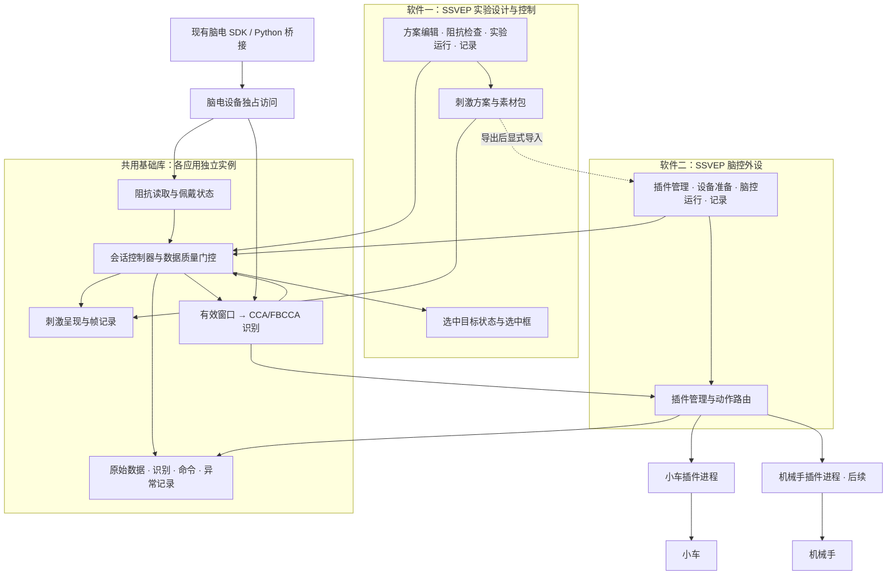
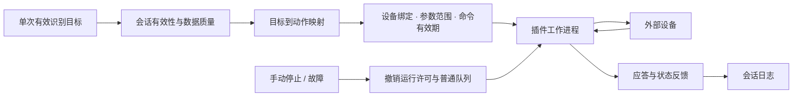
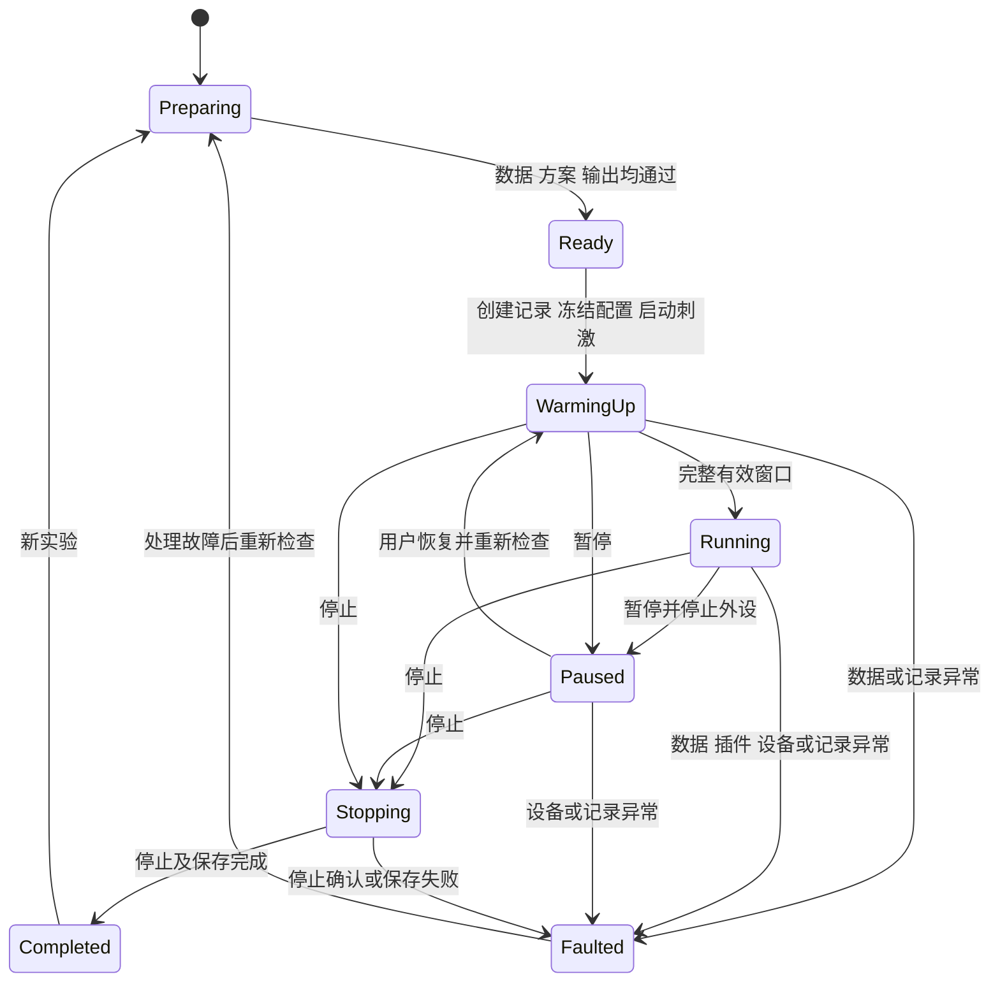

# R01 两套 SSVEP 软件架构与原型设计

版本 0.4 · 2026-09-14 · 设计评审稿

**软件一架构修订：**增加阻抗检测；取消独立结果校验与去重模块，必要检查归入取窗、识别和会话控制；在线识别只显示目标选中框，不提供文本或选择事件输出。详见[软件一架构 1.1](D:/PersonalWorkSpace/ssvep/docs/SSVEP实验设计软件架构.md)。下方 0.3 版原型截图尚未按此更新，作为历史原型保留；小车插件的命令去重与停止职责继续保留。

本版按用户补充的交付口径修订：**软件一为可自定义刺激内容的通用 SSVEP 控制软件；软件二为插件式脑控外设软件，首发小车插件，预留机械手插件。** 两套软件独立启动、配置、记录和验收，共用基础库。替代 0.1 版将通用平台与小车混在一起、把目标编辑器延后处理的设计。

采购文件直接要求 SSVEP 控制软件、至少六个刺激目标、文字/图形/图像自定义、外设及至少两类外设案例。“两套软件”和“插件式扩展”依据本轮用户补充需求确定。原需求编号 R01/R02/R03 保留用于追溯，共同构成软件一的完整交付。

**本版按用户要求简化：取消连续三次确认，单次有效识别即可提交；刺激编码、相位、目标数量、采样率和窗口时长由内部运行配置管理，两个应用均不提供参数调整入口。** 编码、相位、采样率和窗口时长的数值也从用户页面移除；六目标仅作为固定方案标识显示。保留内容编辑和设备动作映射，以下接口、流程、原型和验收均按此修订。

**本轮完成架构与交互原型，不修改生产应用。** 原型使用示例数据、静态目标和模拟反馈；点击代替识别，不连接真实脑电帽或外设。机械手仅展示扩展路径，不表示已有可用硬件插件。

## 1 产品划分

| 产品 | 主要用户与目的 | 必备功能 | 交付形式 |
| --- | --- | --- | --- |
| 软件一：SSVEP 实验设计与控制 | 教师、研究人员；编排刺激与验证脑机交互 | 固定六目标；文字、图形、图像编辑；方案保存与交换；脑电与阻抗检查、在线识别、选中框反馈、记录 | 独立桌面入口与安装包；完整编辑器、模板和手册 |
| 软件二：SSVEP 脑控外设 | 教师、学生、设备开发者；驱动小车并扩展机械手 | 插件管理、设备连接、目标动作绑定、脑控运行、反馈、停止、记录；小车正式插件与开发模板 | 独立宿主安装包；小车插件包；插件 SDK 与语言示例 |
| 未来机械手应用 | 机械手实验与教学 | 机械手连接、动作、限值、状态和专属模板 | 优先作为第二套软件的插件；需要独立入口时提供宿主与插件配置包 |

软件一不依赖软件二运行，软件二也不要求安装或打开软件一。软件二内置可用的刺激模板；可选择导入软件一导出的刺激包。导入只复用目标及素材，设备动作必须在软件二中重新绑定和校验。

原有采集分析软件的波形、滤波和标准文件导出仍按总项目要求核验，不因为两套 SSVEP 应用拆分而遗漏。两套应用不等于两类外部硬件案例，第二类案例仍需真实设备验证。

## 2 总体架构

采用当前 Windows/WPF、C# 核心和 Python 采集桥接基础。共用代码以固定版本的库交付，每个应用拥有独立会话实例；首版不增加远程服务。



图中共用库表示复用实现，不表示两应用同时运行同一个全局会话。UI 不直接访问 SDK 回调或设备协议；插件不直接访问原始脑电或跳过宿主命令检查。软件一的重复识别仅保持同一个选中框，不使用命令去重。

### 2.1 共用、专属与插件的责任

| 层 | 组件 | 责任 |
| --- | --- | --- |
| 公共基础 | AcquisitionService / WindowProvider | SDK 连接与元数据、采样率、数据连续性、算法窗口及全通道记录 |
| 公共基础 | StimulusPresenter | 三类目标内容、动态布局、每帧刺激、开始结束标记与显示质量 |
| 公共基础 | RecognitionService | CCA/FBCCA、单窗调度、算法结果有效性检查；得分不当概率 |
| 公共基础 | ImpedanceService | 各通道阻抗、接触状态、数据时效和识别通道的佩戴就绪检查 |
| 公共基础 | SessionController / Recorder | 唯一会话状态所有者、运行代次、配置冻结、停止和追加式记录 |
| 软件一专属 | Editor / PackageService | 目标编辑、素材管理、合法性检查、保存、预览、导入导出 |
| 软件一专属 | SelectionState / StimulusPresenter | 以选中目标状态驱动唯一选中框；相同目标保持，不形成文本或选择事件输出 |
| 软件二专属 | PluginManager / CommandDispatcher | 插件生命周期、版本、动作列表、绑定、命令有效性、命令去重、停止仲裁 |
| 外设插件 | Vehicle / Manipulator | 设备协议、可用动作、参数范围、应答和遥测；提供默认方案 |
| 界面 | 独立 ViewModel 与视图 | 展示状态快照、发出用户意图，不能自行决定执行资格 |

### 2.2 项目与部署结构

以下为目标组织，允许逐步迁移，现有拼写器功能保留回归基线：

```text
src/
  Ssvep.Studio.App             软件一的 WPF 入口
  Ssvep.DeviceControl.App      软件二的 WPF 入口
  Ssvep.Core                  采样、窗口、识别、决策、会话
  Ssvep.Presentation.Wpf      共用刺激呈现与通用控件
  Ssvep.Infrastructure       SDK 桥接、数据记录、设备独占
  Ssvep.Stimulus.Packaging   刺激包、素材与校验
  Ssvep.Plugin.Contracts     消息、配置、动作、应答的稳定契约
  Ssvep.PluginHost           生命周期、能力协商、路由与健康监测
plugins/
  Vehicle                    首发小车插件
  Manipulator.Sample        后续接口示例；实机版另行验证
sdk/
  Python / Cpp               接入示例与编译说明
```

软件一和软件二分别使用自己的配置、会话目录和安装清单，保存应用 ID 与版本。共用组件固定依赖版本，更新一个产品不静默覆盖另一个产品正在使用的运行环境。

同一脑电帽由一个应用持有独占租约。首版可用机器范围的设备 ID 锁及桥接生命周期管理实现；第二个申请者显示占用应用，不能并行争抢 SDK。跨进程共享采集、多帽同机和同时控制多个外设不纳入首版设计。

## 3 软件一：刺激编辑与运行

**完整范围包含 R01、R02、R03。** 首版固定六个目标，满足不少于六个的要求。原有四十目标拼写器作为代码复用与回归基线，不在本次产品中提供六/八/四十目标选择器。

| 内容 | 用户可操作范围 | 内部处理 |
| --- | --- | --- |
| 名称与文字 | 修改每个目标的名称、显示文字 | 保留稳定目标 ID，不改变目标编码 |
| 图形 | 选择内置图形及经验证的视觉样式 | 按固定目标区域呈现，维持刺激有效面积 |
| 图像 | 替换 PNG/JPEG 素材及说明文字 | 预解码并保存相对素材引用，避免逐帧读盘 |
| 数量与布局 | 六个固定目标位置，编辑各位置的内容 | 不提供增减目标、数量切换及改变目标拓扑的布局入口 |
| 编码、相位 | 不开放 | 固定频率表、相位、刺激方式归属内部运行配置 |
| 采样率、窗口时长 | 不开放 | 接入时核验设备实际采样率，匹配已验证配置并锁定；固定窗口时长 |
| 运行 | 连接、开始、暂停、恢复、结束 | 内部准备数据并完成识别；一次有效结果提交一次 |

保存草稿可暂存内容问题，进入运行前校验目标 ID、内容非空、素材存在及其与内部六目标模板的一致性。频率唯一性、相位和显示时序由内部配置校验；用户不能通过高级设置、导入文件或插件表单改写这些字段。当前 CCA/FBCCA 不能可靠区分仅相位不同的同频目标，此约束由开发维护的配置负责。

方案包分离为“内部运行配置引用”和“可编辑内容”。用户导入导出只交换六个目标的内容、素材及兼容的配置引用，不接受频率、相位、目标数量、采样率、窗口时长的覆盖。模板不匹配时拒绝导入，不能自动扩展目标数。实际使用的完整参数快照仍写入内部日志用于追溯，不在普通用户页面展示。

本轮原型支持目标选择、文字/图形修改、图像文件选择、演示保存与重新载入、静态运行和记录。固定六目标；一次点击代表一次已经完成的有效识别，并立即提交模拟结果。正式识别仍需完整脑电窗口，单次提交不代表只采一个样本或免除数据准备时间。演示保存只在原型页面内存中。


## 4 软件二：插件式脑控外设

插件是明确的扩展边界。小车和机械手分别实现同一外设契约，独立打包、版本化和联调；宿主不写死“小车/机械手”的动作分支来驱动真实设备。



### 4.1 首发小车与后续机械手

| 项 | 小车插件 | 机械手插件 |
| --- | --- | --- |
| 连接 | 根据选定车体的串口、蓝牙或网络协议实现 | 根据机械手现有控制器协议实现 |
| 默认目标 | 前进、后退、左转、右转、停止、暂停脑控 | 示例：张开、闭合、上移、下移、停止、暂停脑控 |
| 动作语义 | 转向方式、速度、点动时长由能力描述明确 | 坐标系、行程、力度或电流、限位由能力描述明确 |
| 可视反馈 | 连接、命令应答、可观测的电量/速度等 | 连接、夹爪开合、可观测的位置/限位等 |
| 交付顺序 | 首发正式插件与实机案例 | 先模板及模拟契约验证，后独立实机插件 |

小车不默认具备“自动归位”，普通夹爪不默认具备上下移动。无真实传感或回报时不显示虚构位置或动作完成；本轮原型中的空间反馈全部标注模拟。

### 4.2 插件方式选择

首版采用**子进程插件 + 声明式设置与状态界面**。宿主通过本机管道交换结构化消息，插件程序可用 C#、Python 或 C++ 实现；插件异常不直接崩溃 UI。相较进程内 DLL，这会增加通信和生命周期开发，但更适合后续设备驱动和语言差异。

宿主统一生成连接配置、动作绑定和状态面板，插件不接管脑电识别或刺激时序。首版不做在线插件市场、运行中热更新、任意 UI 注入或三维运动规划。

详细包结构、消息、动作、兼容性、故障和验收见[插件接口与扩展规范](D:/PersonalWorkSpace/ssvep/docs/R01插件接口与扩展规范.md)。

## 5 会话、时序和数据契约

| 对象 | 必须保存的内容 | 约束 |
| --- | --- | --- |
| SessionContext | 应用 ID、会话 ID、配置版本、数据来源、输出模式、目标与通道表 | 开始后不可原地修改；真实与模拟输出隔离 |
| StreamDescriptor | 设备、SDK/固件、实际采样率、单位、输入通道、StreamEpoch | 重连、序号重置、速率或通道改变时更换代次 |
| WindowSnapshot | 起止样本、刺激区间、实际采样率、数据有效性 | 不跨暂停、试次或采样配置混窗 |
| RecognitionResult | 会话、RunEpoch、窗口、候选、得分、耗时 | 结果过期即丢弃，不能恢复旧候选 |
| ControlCommand | 唯一命令 ID、设备 ID、DeviceEpoch、动作、参数、截止时间 | 宿主与插件发送前分别复核；未知运动结果不盲目重试 |
| Receipt | Sent、Accepted、Executing、Completed、Failed、Unknown | 已发送、设备已接收与动作已完成分别记录 |

暂停、停止或故障使 RunEpoch 失效；插件重连使 DeviceEpoch 失效；旧代次计算和回包都不能产生新的动作。UTC 用于检索，单调时钟用于耗时，设备相对时间用于采样关联；不同进程时钟需明确换算。

内部窗口必须按设备实际采样率换算，例如内部方案设为 2.5 秒时，250 Hz 取 625 样本，500 Hz 取 1250 样本。两种速率的支持属于 SDK/设备及内部配置验证，SSVEP 用户界面没有切换入口。接入的实际速率与已验证配置不匹配时阻止开始，不按固定 250 Hz 假定解释其他速率数据。开始或恢复后仍等待刺激起点之后的完整有效窗口。

两套软件都不等待第二或第三个分类结果，也不要求人工确认。软件一在有效窗口与算法结果检查后，由会话控制器核对当前运行状态及代次，直接更新唯一选中框；相同目标保持原框，无独立去重模块。软件二由命令派发模块检查动作许可、命令有效性和重复命令，内部动作间隔只限制重复派发，不累积多个候选进行确认。停止、暂停和故障清除软件一选中框，并撤销软件二尚未执行的动作。

计算采用一个在途窗口加一个最新待处理窗口，避免积压旧决策。日志使用有界队列，原始数据不能静默丢弃；溢出或落盘失败进入可见故障。绘制线程只负责渲染和时间标记，不等待设备通信、分类或磁盘。

## 6 状态、停止与恢复

以下包含软件二的外设停止分支。软件一沿用准备、运行、暂停、结束和故障状态，但停止行为为停止刺激、清除选中框及撤销旧识别结果，不创建外设命令或等待外设应答。两者准备检查均包含当前识别通道的有效阻抗状态。



启动事务中任一步骤失败都回滚已准备资源并记录错误。停止先关闭普通命令资格、撤销候选和队列，再调用独立停止路径；不能等普通队列耗尽。暂停同样停止外设，恢复须重新积累窗口。

停止显示三种真实状态：已请求、设备已确认、设备状态未知。插件崩溃或链路断开后，仅退出进程不能保证物理停止；运动设备需设备侧看门狗或有限时长动作协议。停止与发送竞争、迟到结果、设备失联和恢复不重放均列为验收项目。

## 7 两套原型

两个原型各有独立应用外壳与状态，不是一个产品中的场景选项。配色、刺激组件与基础流程保持一致，便于形成同一套件。

### 7.1 软件一：方案编辑、运行与记录（0.3 版历史原型）

以下描述与图片保留上一版原型。最新架构要求补充阻抗检查，并把运行页的识别结果与选择记录区改为仅显示目标选中框；本轮尚未更新 HTML 和截图。

默认打开刺激内容编辑，六个目标直接展示文字、图形、图像。右侧仅编辑名称、类型和具体内容；空内容等问题阻止进入实验。运行页直接显示单次识别结果与选择记录，删除候选确认计数及进度条。页面没有受限参数调整入口，也不显示编码、相位、采样率和窗口时长数值；六目标标识仅说明当前固定模板。保存、载入和记录采用本页内存模拟。


### 7.2 软件二：小车控制与插件扩展

原型默认打开插件管理页，展示首发小车与机械手扩展。设备准备、动作映射、脑控运行、插件管理和记录有独立入口。运行区保留显眼停止操作；配置与插件切换在运行及暂停时锁定。

插件管理列出小车和机械手扩展示例，可演示安装与启用机械手模拟插件；切换后设置、动作表和反馈区跟随能力变化。此交互说明未来开发机制，不表示原型已安装真实插件。


## 8 方案、配置与记录

刺激内容包可在两个产品间显式交换，内部编码与采集运行配置不能由内容包覆盖；应用配置、插件连接凭据、设备绑定和会话日志不随内容包复制。软件二导入后生成本地方案版本，动作只可绑定当前插件声明且实际设备支持的能力。

每个会话建议保存：session.json（应用、核心、SDK、插件版本及摘要、配置）、samples（全部 SDK 输入与无效标记）、frames.csv（刺激和帧）、events.jsonl（状态、决策、命令、应答）、summary.json（结束与完整性）。不带独立真值的自由控制会话不显示准确率。

下次启动识别未正常结束记录，标为不完整。导入或升级保留旧数据，不覆盖原有实验；记录须能从目标追到刺激、分类样本、动作、插件和设备应答。

## 9 实施顺序与新增工作量

本轮只设计。后续实施先固定接口，再实现小车，之后新增机械手，避免两个应用各复制一套算法。

| 顺序 | 工作 | 阶段证据 |
| --- | --- | --- |
| 1 | SDK 能力核验、设备协议确定；提取共用会话和动态窗口 | 原拼写器回归、250/500 Hz 与窗口证据 |
| 2 | 软件一独立入口、完整目标编辑与方案包 | ≥6 目标，三类内容编辑与异机加载 |
| 3 | 软件二宿主、插件契约与模拟端 | 独立启动、配置生成、插件加载和故障处理 |
| 4 | 首发小车插件与设备联调 | 真实命令、反馈、停止与看门狗记录 |
| 5 | 机械手模板与新增插件验证 | 不修改宿主加载示例；实物版单独联调 |
| 6 | 两应用发布、SDK、教学资料与整套验收 | 安装包、示例、记录和试运行闭环 |

原方案 34–53 人日的基础估算包括目标编辑、通用外设适配和两类案例，但没有覆盖两个独立产品及完整子进程插件生命周期。新增工作估算如下，不能把原预算当作已包含全部扩展能力。

| 增量包 | 范围 | 人日 |
| --- | --- | --- |
| X01 | 两应用入口、独立配置、设备独占及分开打包验证 | 2–3 |
| X02 | 插件发现、清单与版本校验、子进程协议、加载及故障恢复 | 4–6 |
| X03 | 声明式设置/状态、能力驱动动作映射、模板与契约测试 | 3–5 |
| 增量合计 | 不重复计算原编辑器及两类设备业务适配 | **9–14** |

按原范围加上述增量，基础为 **43–67 人日**；统一加约 20% 联调预留后 **52–81 人日**，单人全职开发约 11–17 周，15 个工作日试运行另列。若全套采集软件三项补充都需新增，则基础 51–81、含预留 62–98 人日。以上为设计阶段估算；外设无既有协议、SDK 大版本迁移、复杂机械手规划需重新评估。

本次界面收敛和单次结果流程调整纳入上述范围；人日区间暂保留作预算参考，实施前按收敛后的工作包复核，不据界面控件数量直接换算开发时间。

机械手可作为第二阶段实施，不把未实施部分计为已交付。最终若沿用招标的两类外设案例要求，必须在整套验收前完成第二类真实硬件案例；本轮只确定扩展接口不免除该项。

## 10 本阶段与后续验收

| 对象 | 本轮可评审 | 后续实施通过条件 |
| --- | --- | --- |
| 软件一 | 固定六目标的内容编辑、运行和记录 | 三类内容无代码编辑，保存重启和异机导入；受限参数无入口且导入不能覆写 |
| 软件二 | 准备、动作映射、运行、插件管理、故障和记录 | 小车真实脑控与应答；正确停止；独立部署，不依赖软件一进程 |
| 扩展架构 | 包、契约、版本、生命周期及开发步骤 | 不改宿主接入新模拟插件；语言示例可构建；机械手实物单独验收 |
| 共用基础 | 单次结果提交、内部参数、时序及异常策略 | 一个有效结果即可提交且只提交一次；无效/过期结果拒识；暂停/停止无迟到动作；实际采样率与内部窗口匹配 |

原型检查只证明界面和模拟交互。实际频率、帧质量、脑电识别效果、设备通信、物理停止及 Python/C++ 插件需要后续生产实现和实测。

本版原型完成 8 类交互与参数入口检查：固定目标内容编辑、单次结果直接提交、内容及连接校验、动作映射执行、暂停/停止与配置锁定、机械手插件示例、故障恢复、全部页面受限参数无入口。8 个页面在 320、360、736、1024 像素宽度及浅色/深色外观下完成 64 组布局检查，未发现横向越界或脚本错误；已查看主要页面和窄屏截图。[本版验证记录](D:/PersonalWorkSpace/ssvep/outputs/r01-design-v03/prototype-validation.json)仅证明原型交互，算法、SDK、导入包和真实插件契约仍需后续实现及实测。

## 11 代码与需求依据

- [总体定制方案与验收标准](D:/PersonalWorkSpace/ssvep/docs/SSVEP定制开发方案.md)：需求矩阵、总工作量及实机验收。
- [插件接口与扩展规范](D:/PersonalWorkSpace/ssvep/docs/R01插件接口与扩展规范.md)：第二套软件的完整扩展边界。
- [MainWindow.xaml.cs](D:/PersonalWorkSpace/ssvep/src/Ssvep.Speller.App/MainWindow.xaml.cs)：现有会话、分类和文本提交。
- [StimulusCanvas.cs](D:/PersonalWorkSpace/ssvep/src/Ssvep.Speller.App/StimulusCanvas.cs)：现有固定布局与刺激绘制。
- [SynchroniBridgeEegStream.cs](D:/PersonalWorkSpace/ssvep/src/Ssvep.Speller.Core/Devices/SynchroniBridgeEegStream.cs)：真实采集桥接。
- [FbccaClassifier.cs](D:/PersonalWorkSpace/ssvep/src/Ssvep.Speller.Core/Classification/FbccaClassifier.cs)：现有分类基础。
