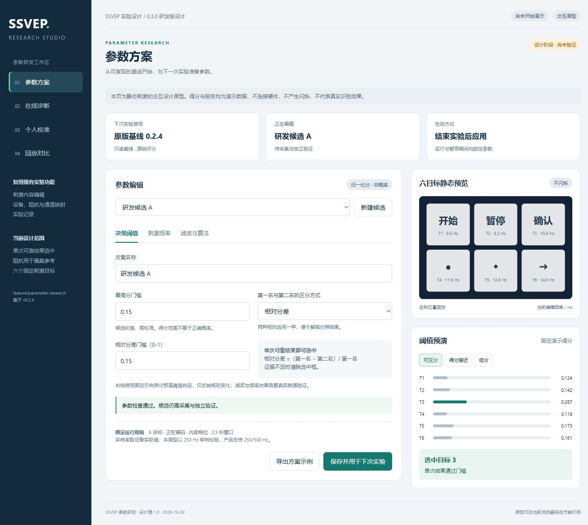
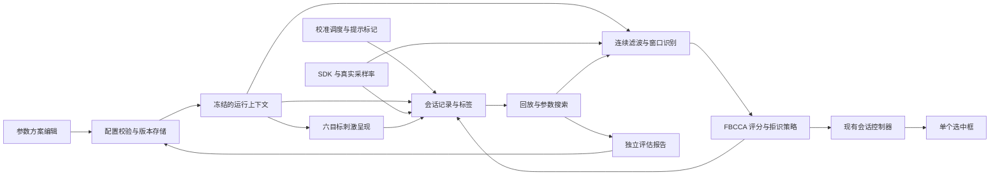

# SSVEP 参数研发版本设计

设计稿 1.0 · 2026-10-02 · 分支 `feature/parameter-research`

本版本面向研发人员，目标是找出适合当前设备、显示器和使用者的 SSVEP 参数，减少注视时选错及未注视时误触发。建议目标版本为 **0.3.0 研发版**，以已发布的 `v0.2.4 / 911bd19` 为对照基线。

本次交付为设计文档和[交互原型](prototypes/parameter-research.html)。原型使用演示得分和虚构报告数据，不连接设备、不产生闪烁刺激，也不修改桌面软件配置；本分支尚未实现下述运行能力。



## 1 版本范围

首版采用现有 WPF、Synchroni SDK 和 FBCCA 路线，增加参数方案、在线诊断、个人校准、回放评估。先让参数可解释、实验可复现，再根据独立测试结果选择默认方案。

| 功能 | 本版设计 |
| --- | --- |
| 阈值 | 开放最高分、绝对或相对分差；显示拒识原因；阈值不解释为正确概率 |
| 刺激频率 | 可分别设置六个固定目标的频率；稳定目标 ID 和位置，不因频率排序而移动目标 |
| 软件滤波 | 对照原版 FIR 与连续 SOS 带通；开放三个子带边界、谐波数量、子带权重及软件陷波选项 |
| 个人校准 | 带提示采集目标注视、无意图及切换片段，保存标签，生成候选参数 |
| 在线诊断 | 六目标得分、第一第二名差距、拒识原因、有效窗口比例、丢样、绘制帧率与帧间隔 |
| 回放评估 | 同一数据上比较算法、滤波和阈值；有标签才计算正确率；保留基线结果 |
| 输出 | 受试者刺激区仅显示选中框；研发人员在诊断区看内部结果，无文本累积或外设命令输出 |
| 固定项 | 六目标、正弦亮度编码、内部相位、2.5 秒窗口；采样率由设备元数据确定，支持 250/500 Hz |
| 后续范围 | eCCA/TRCA 个人模板列入后续对照；脑控小车、机械手与插件宿主不进入本版 |

单次符合条件的结果直接显示选中框，不进行连续三次确认。阻抗继续显示与记录，不参与开始或恢复条件。SDK 丢样继续显示计数，丢样窗口失效后重新积累，保持设备连接。

## 2 基线与研发候选

当前实现的频率为 8、9.2、10.4、11.6、12.8、14 Hz，采用三个子带和三次谐波，最高分门槛 0.1、绝对分差 0.02。子带为 8–90、16–90、24–90 Hz，129 抽头 FIR 在各窗口边缘进行反射处理。配置来源分别为 `StudioRuntimeProfile`、`StudioSessionController`、`FbccaClassifier` 和 `FilterBankDecomposer`。

原版基线只读，必须能按原算法、原评分单位回放。研发候选另存版本，避免更新实现后仍把结果标成原版基线。

| 参数 | 原版基线 | 首个研发候选 | 编辑与校验 |
| --- | --- | --- | --- |
| 最高分门槛 | 0.1 原始分 | 0.15 归一化分 | 研发输入 0–1；初始扫描 0.10/0.12/0.15/0.18/0.21 |
| 分差规则 | 绝对分差 ≥0.02 | 相对分差 ≥0.15 | 绝对、相对二选一；绝对分差候选 0.015/0.025/0.035/0.045；相对候选 0.10/0.15/0.20 |
| 频率 Hz | 8/9.2/10.4/11.6/12.8/14 | 首轮沿用基线；对照组 9/10/11/12/13/14 | 首轮研发范围 8–16，步长 0.1；必须六个有限且不同的值；间隔小于 1 Hz 或低阶谐波碰撞给出提示 |
| 软件带通 Hz | 8–90/16–90/24–90 | 6–48/14–48/22–48 | 必须 0 < 下限 < 上限 < 实际奈奎斯特频率；第一子带覆盖六目标基频；显示谐波被滤除的提示 |
| 滤波实现 | 原版窗口 FIR | 连续 SOS IIR | 候选采用四阶 Butterworth 原型，实际带通八阶；按实际系数、频响、稳定性与延迟验收 |
| 参考谐波 | 3 | 3，对照 2 | 与子带数解耦；首轮保持三个可配置子带 |
| 子带权重 | n^-1.25 + 0.25 | 初值沿用 1.25/约0.670448/约0.503279 | 权重有限、非负且总和大于零；存储完整精度 |
| 软件陷波 | 无额外软件陷波 | 默认关闭，可选 50/60 Hz | 开启时 Q 初值 30，研发范围 10–60；提示与目标谐波冲突；同时展示 SDK 滤波状态 |
| 窗口与调度 | 2.5 秒，约 200 ms 检查 | 相同 | 不提供用户修改入口；实际结果速率受计算和数据完整性影响 |

上表均为设计选择或候选起点，不代表已验证的最优参数。改变频率、滤波、谐波、权重或通道组合后，需要重新标定阈值。显示器刷新率和帧间隔应记录；界面 FPS 不能替代物理刺激频率测量。

研发评分定义为 `S(k) = Σ(w(b) × ρ(k,b)²) / Σw(b)`，范围为 0–1，但仍不是概率。相对分差为 `(S1-S2)/max(S1,ε)`。原版三子带权重之和约 2.423727，原始分与归一化分不能混用；迁移方案时明确提示单位，禁止静默套用原始阈值。

## 3 页面与操作流程

复用现有刺激内容、设备与阻抗、实验记录页面。研发工作区增加四个页面，界面顶部始终标识研发版本和当前参数方案。

| 页面 | 主要内容 | 主要动作 |
| --- | --- | --- |
| 参数方案 | 方案列表、来源基线、验证状态；决策、频率、滤波三个页签；固定规格摘要 | 新建候选、另存修订、导入导出、设为下次实验方案 |
| 在线诊断 | 六目标刺激与选中框；可折叠得分面板；绘制 FPS、帧间隔、丢样、有效窗口比例 | 开始、暂停、恢复、结束；选择是否显示研发诊断 |
| 个人校准 | 佩戴与映射检查、随机试次、注视提示、无意图提示、质量标记与进度 | 开始校准、休息、标记无效试次、补采、生成候选、独立验证 |
| 回放对比 | 会话与标签信息、基线和候选、候选任务队列、混淆矩阵、误触发与延迟 | 选择记录、执行对比、导出报告、另存推荐方案 |

典型流程：选择基线 → 新建研发候选 → 调整参数并检查 → 保存并设为下次实验方案 → 校准采集 → 离线选择候选 → 用新采数据验证 → 将通过验证的候选设为默认。

### 参数修改的生效规则

草稿允许编辑；启动实验时，运行上下文冻结方案修订、内容、通道映射、设备采样率和算法版本。呈现、识别和记录必须引用同一快照。

运行和暂停期间均锁定参数；结束并写完记录后才能编辑。修改频率时创建新会话，清除滤波状态、历史窗口和旧选中结果。禁止把旧频率的样本交给新频率参考信号。导入内容包不能覆盖研发参数；参数包出现受限字段或未知字段时拒绝导入并提示字段名。

拒识时清除当前框并显示简短原因，如“最高分不足”“目标得分接近”“等待连续数据”。低证据不能显示成已确定的无意图状态。异常窗口恢复后，单次可靠结果即可选中；不引入命令去重服务或多次投票。

### 诊断显示与呈现性能

绘制帧率、帧间隔分位数及长帧次数分开显示。得分条和数值最多约 5 Hz 更新，使用缓存和批量 UI 通知；图表不参与刺激时钟。计算采用单任务后台调度，始终处理最新完整窗口，不积压历史任务。诊断面板的开关和尺寸变化不能改变刺激区域的固定几何布局；正式测量前固定布局并记录尺寸。

## 4 软件结构



以上为同一进程中的职责分工，不新增微服务。拒识策略作为纯计算组件供在线与回放复用；会话状态与结果时效仍由现有控制器负责。

| 位置 | 设计调整 |
| --- | --- |
| `Core/Research/ResearchProfile` 与校验器 | 强类型参数、字段范围、只读基线、评分版本、修订与内容哈希；禁止受限字段注入 |
| `Studio/StudioRuntimeProfile` | 保留原版基线，增加从已验证方案创建只读运行上下文的入口 |
| `Classification/FbccaClassifier` | 配置化频率、谐波、子带和权重；分别保存原始与归一化分，增加算法版本 |
| `Classification/FilterBankDecomposer` | 保留原版 FIR；增加有独立通道状态的连续 SOS 实现、预热和重置规则 |
| `Classification/CcaMath` | 对照验证协方差正则化及稳定矩阵求解；正则项按信号尺度设置，避免固定绝对量导致数值偏差 |
| `Core/Research/SelectionPolicy` | 最高分与分差判据、拒识原因；后续接入已校准的响应检测器，不管理连接和窗口生命周期 |
| `StudioRuntime` 与 `StudioStimulusView` | 将同一运行上下文传给刺激、算法和模拟源；维护现有代次检查与最新窗口调度 |
| `Core/Research/CalibrationScheduler` | 试次随机化、提示时刻、无意图区间、休息、补采和标签有效性 |
| `Core/Research/ReplayEvaluator` | 按原顺序重放样本、缺口和状态，复用在线流水线，按试次或实验批次划分数据 |
| `StudioRecorder` | 增加配置、算法、固件滤波状态、标签和拒识原因，兼容旧记录读取 |
| `Studio.App` 研发视图 | 参数方案、诊断侧栏、校准和回放结果；复用现有设备连接、头图及内容编辑 |

代码路径中的 `Core` 指 `src/Ssvep.Speller.Core`。新类型和职责是设计建议，并非已经存在的实现。

### 数据连续性与滤波状态

每个采集通道、每个子带独立维护滤波状态。开始、暂停恢复、真实断连、采样率或配置变化时重置；丢样缺口也重置并重新预热，缺口前后的数据不能直接拼接。滤波预热区不参与识别；滤波群延迟与计算延迟记录到报告。

离线回放复现同样的重置、预热和窗口规则，不能用全段双向零相位滤波的结果冒充在线性能。固件滤波已改变的信号无法靠软件回放恢复为未滤波信号。

SDK 的请求设置、返回结果和可读回状态分别记录。无法查询高低通截止频率或 50/60 Hz 陷波实际状态时，显示“未核验”，允许带该标记采集；不能显示成确定关闭。先修正桥接开关的显式 ON/OFF 处理，再做固件滤波对照。阻抗异常不作为过滤数据或禁止开始的唯一依据。

## 5 参数与记录格式

参数文件采用独立的 `.ssvep-research.json`，内容方案继续使用现有 `.ssvep.json`。每次保存新修订；内置原版基线不可覆盖。当前默认方案与个人候选分开存储，不因导入文件自动替换默认。

参数结构示意如下，实际持久化还应加入创建时间、内容哈希与算法兼容信息：

```json
{
  "schemaVersion": 1,
  "profileId": "research-candidate-a",
  "revision": 1,
  "name": "研发候选 A",
  "algorithmVersion": "fbcca-research-v1",
  "scoreVersion": "weighted-rho2-normalized-v1",
  "targetFrequenciesHz": [8.0, 9.2, 10.4, 11.6, 12.8, 14.0],
  "filter": {
    "method": "butterworth-sos",
    "prototypeOrder": 4,
    "bandsHz": [[6, 48], [14, 48], [22, 48]],
    "softwareNotchHz": null,
    "notchQ": 30
  },
  "harmonicCount": 3,
  "bandWeights": [1.25, 0.6704482076268572, 0.5032785618838642],
  "decision": {"minScore": 0.15, "gapMode": "relative", "minGap": 0.15},
  "validationStatus": "unvalidated"
}
```

目标数量、编码、相位、采样率和窗口时长不属于可导入的参数字段。设备实际采样率及固定运行规格写入只读会话清单；回放必须读取原会话清单，不能使用当前连接设备的数值替代。

会话清单增加：参数快照及哈希、算法和软件版本、实际通道顺序、参考/接地说明、SDK 版本、固件滤波请求/响应/核验状态、显示器及刺激区域信息。设备地址只保留在本地需要的记录中，导出研究报告默认脱敏。

事件增加 `trial-marker`、`label`、`window-quality`、`decision-diagnostic`、`filter-reset`；记录实际提示帧的单调时钟与采样位置，不能只记录发出 UI 更新请求的时间。标签区分目标 ID、无意图、切换、休息和未知。提示标签表示实验指令，不能声称眼动已确认实际注视。

个人参数适用范围绑定参与者代号、设备/电极布局、通道顺序、显示条件、频率与处理链。条件改变后标记“需要复核”，不沿用“已验证”状态。即使生成了内容哈希，导入文件自带的已验证标记也不能替代本地验证记录。

## 6 校准与拒识设计

一套固定频率方案的基础校准约 8–10 分钟，不含频率组对照和独立验收。建议六目标各 10 次，注视 4 秒、提示及转移共 2 秒，合计约 6 分钟；另采约 3 分钟无意图片段。按平衡随机顺序安排试次并保存随机种子，加入自然眨眼和目标切换。

无意图采集时保留同样的六目标闪烁，提示看中央空白区或目标外；不能只用闭眼或关刺激数据代替实际空闲情况。用户可标记走神、移动或接触调整，对受影响试次补采，不能悄悄删除表现差的有效试次。

第一阶段使用可解释的最高分加分差拒识。校准阶段基于目标和无意图数据选择阈值；若两者明显重叠，再评估使用最高分、分差和谐波信噪比的轻量响应检测模型。必须在独立数据上优于简单阈值才启用，不把高分直接称为识别到了控制意图。

调参按试次/批次划分训练与验证集，同一试次的所有重叠窗口只能进入同一分组。先调滤波和谐波，再针对各处理链校准阈值，控制搜索数量并记录搜索范围。最终另采一批数据测试，不能用测试结果反复挑参数后仍称为独立测试。

eCCA/TRCA 为后续算法对照，需要单独验证校准与在线窗口的时间、相位对齐。当前连续闪烁和任意起点滑窗，不能直接套用按提示对齐的模板。参考：[FBCCA](https://doi.org/10.1088/1741-2560/12/4/046008)、[异步检测与分类](https://pmc.ncbi.nlm.nih.gov/articles/PMC11026332/)、[TRCA](https://pubmed.ncbi.nlm.nih.gov/28436836/)。这些研究提供方法依据，不提供当前设备的已验证参数或性能承诺。

## 7 回放与对照边界

| 变化 | 能否使用同一份旧记录评估 |
| --- | --- |
| 最高分和分差阈值 | 可以；复用评分可快速计算，但记录必须注明评分版本 |
| 软件滤波、参考谐波、权重、数值算法 | 可以从采集样本重新运算；保留 SDK 已施加的滤波，不能宣称原始未滤波 EEG |
| 刺激频率、相位、屏幕、刺激面积 | 需要重新采集；把参考频率改成新频率不等于测试了新刺激方案 |
| 电极位置、设备或硬件滤波 | 通常需要重新采集；已记录的通道子集可在适用时离线比较，但不能补出未采通道 |
| 旧版无标签记录 | 可以看得分分布、拒识率、切换和连续性；正确率、误触发率显示“缺少标签” |

频率 A/B 对照保持设备、佩戴、内容、显示布局和测量协议一致，交替或平衡安排顺序，控制疲劳和先后次序影响。按每目标信噪比、混淆情况、无意图误触发和使用舒适度共同选频率，不仅看总体正确率。

## 8 验收与报告口径

工程验收与真人性能分别报告。以下性能为首轮研发目标，不是已达成结果；样本量、参与者、条件及区间估计随报告给出。

| 指标 | 定义与目标 |
| --- | --- |
| 接受结果正确率 | 独立目标试次中正确的首个接受结果 / 所有有接受结果的试次；目标 ≥95% |
| 有效决策覆盖率 | 规定 4 秒决策时限内有接受结果的目标试次 / 全部有效目标试次；目标 ≥80% |
| 无意图误触发 | 无意图区间内，未选中转为选中或选中目标改变算一次；同一目标连续显示不按每窗重复计数；目标 ≤0.2 次/分钟 |
| 错误显示时长 | 无意图区间显示任意选中框的时长占比，同时报告最长持续时间，避免长时间错误保持掩盖问题 |
| 决策延迟 | 从注视指令标记至接受结果；正确与错误分别报告，正确结果中位数目标 ≤3 秒，同时报告 P95 和超时率 |
| 独立测试量 | 至少六目标各 10 次及 10 分钟无意图测试；另做连续切换试验，不能将数百个重叠窗口当作数百次独立试验 |

每个试次的首个接受结果决定正确或错误，错误后再选对不能覆盖早先误选。用于训练的稳态片段与切换片段分开标注；在线切换测试保持正常连续运行，不能靠利用真值标签清空窗口来提高结果。若校准试次按提示重置窗口，其结果只能标为提示式测量，不得替代连续使用结果。

工程必验：原版基线回放一致；250/500 Hz 均按实际采样率处理；非法/受限参数不能应用；运行与暂停锁定；丢样及滤波重置；过期结果不回写选中框；相同配置和数据产生一致回放结果；无标签报告不生成正确率；导入候选不覆盖内置基线；诊断面板与长时记录下的呈现性能可量化。

## 9 实施顺序

| 阶段 | 交付 | 完成条件 |
| --- | --- | --- |
| P1 参数与诊断 | 参数方案、评分单位、共享运行快照、三子带配置、阈值拒识原因、实时诊断 | 可在模拟和 SDK 记录回放中复现参数，保留只读基线；预计 2–3 人日 |
| P2 校准与评估 | 标签采集、随机试次、无意图区间、回放搜索与报告 | 标签和分组正确，指标按试次计算，候选需新数据验证；预计 3–4 人日 |
| P3 实测与固化 | 显示/SDK 滤波核验、频率对照、个人默认方案、研发包 | 完成设备与显示条件下的独立验证；预计 1–2 人日工程支持，采集排期另计 |

工时为当前代码基础上的初步估计，视 SDK 读回能力及实测反馈调整。待校准数据支持后，再单独安排 eCCA/TRCA 对照，不将其效果计入本版承诺。

本次分支只保存设计与原型。实现阶段沿本分支开发和提交，验收后再合并主分支并发布带研发标识的新版本；现有 `v0.2.4` 标签保持作为对照基线。
