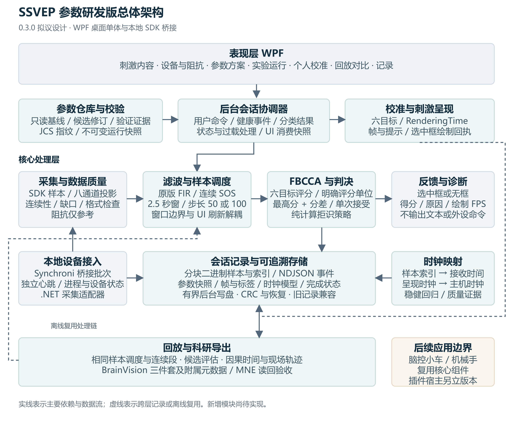
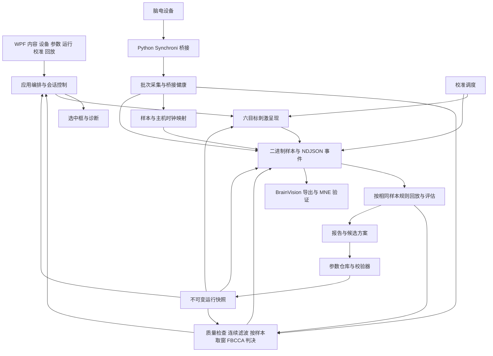
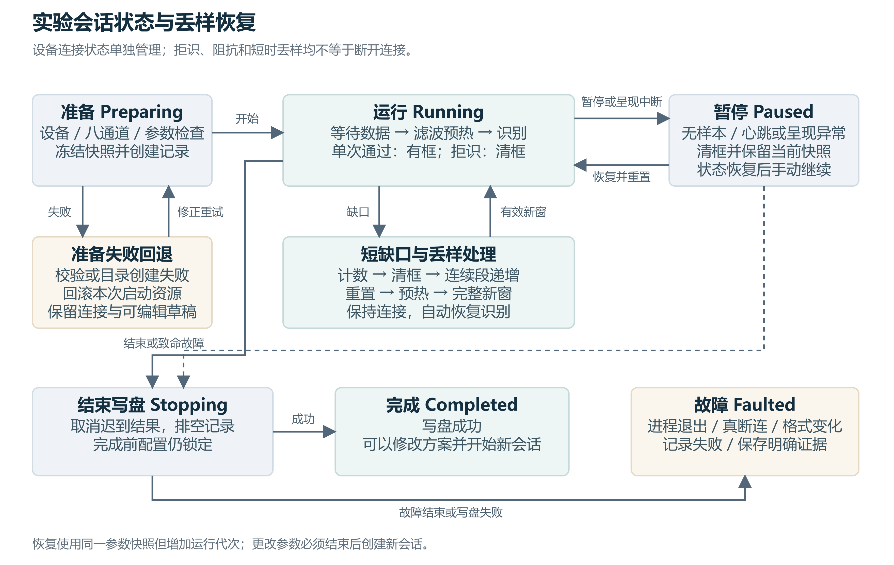

# SSVEP 参数研发版架构设计

文档版本 1.4 · 目标软件版本 0.3.3 · 2026-10-17 · 状态：研发实施稿

本文将[产品需求](SSVEP参数研发版PRD.md)落实为模块、配置、数据流、会话状态和验证方案。以 0.2.4 的 WPF 应用、Synchroni SDK 桥接和 FBCCA 为基础，采用模块化桌面单体，复用同一识别链完成在线识别与回放。0.3.0 已形成工程实现；设计中的职责在实现时作了类名与文件组织合并，准确文件映射、实现差异和验证边界见[实施记录](SSVEP参数研发版实施记录.md)。Word 1.1 保留原始设计稿。

1.1 修订将识别改为样本索引驱动，补齐时钟映射、RenderingTime、JCS、桥接健康、二进制样本和 BrainVision，并补上 Preparing 失败回退。本文取代 1.0 中的 UI 定时取窗、逐样本 NDJSON 和虚拟时间选窗设计。

1.2 修订普通个人校准：四组顺序目标，提示 1 秒、实际反馈 4 秒、等待 0.5 秒；增加独立提示框和反馈显示约束，识别调度仍按样本推进。

## 1 架构目标与约束

本版优先解决配置一致性、结果可解释性和实验可复现性。无需微服务、网络消息总线、账号服务或外设命令路由。现有单次结果检查保留在会话控制器中，只负责状态、代次、窗口新鲜度及结果合法性；这类检查防止旧结果污染会话，不扩展为独立去重子系统。

必须成立的约束如下：

1. 每个会话只有一个不可变运行快照；刺激频率、参考信号、模拟源和日志读取同一快照。
2. 六目标、编码、相位、采样率来源、2.5 秒窗口保持内部约束；研发文件不能覆盖。
3. 一次合格判决即可选中；拒识、暂停及无效数据清框；不要求连续三次确认。
4. 阻抗仅作参考。丢样告警不直接断开，缺口不得用补零或拼接伪装成连续 EEG。
5. 不同会话、运行代次、滤波连续段及评分单位的结果不得混用。
6. 原版基线和研发处理链分别版本化；新数值算法不覆盖原版实现。
7. 当前识别输入为八个有效通道，顺序固定并记录；不根据未填写的电极映射推测位置。
8. 窗口只由样本索引、连续段锚点、预热长度和固定步长决定；UI 与回放速度不决定窗口边界。
9. 原始时间戳和样本计数始终保留，时钟拟合不得覆盖采集证据或追改已经应用的在线标签。

## 2 总体架构



图中模块主要位于同一 .NET 进程，Python SDK 桥接为本地子进程。回放任务与在线实验互斥使用计算资源；记录在独立后台写入。图中的后续应用边界仅表示可复用方向，本版没有脑控小车或机械手插件。



### 2.1 分层与依赖

表现层负责内容编辑、参数表单、头图、刺激绘制和结果展示；后台应用协调器拥有会话状态，串行处理用户命令、健康事件与分类结果；核心层负责配置校验、样本调度、信号处理、时钟模型、判决、标签和指标。UI 只发送命令并消费状态快照，不持有识别定时器。文件系统、时钟、SDK 与显示信息由应用层注入，核心层不引用 WPF、Python 进程管理或外设 SDK。

刺激呈现只订阅冻结配置和选中目标，不读取编辑控件。分类与回放只使用数据对象，不读 UI 或当前连接设备状态。参数仓库保存候选与验证证据，不能直接修改正在运行的分类器。

## 3 模块与代码落点

下表中 Core 表示 `src/Ssvep.Speller.Core`，App 表示 `src/Ssvep.Studio.App`；“新增”表示相对于 0.2.4 的设计职责，实际类名见实施记录。

| 模块与位置 | 职责 | 对应需求 |
| --- | --- | --- |
| App 既有内容页与 StudioContentService | 六目标素材校验、保存与快照 | FR01 |
| App StudioHeadMap 与 Core StudioElectrodes | 手动通道映射、选通道和持久化 | FR02 |
| Core Devices 与 Python bridge | 样本批次与接收时间、设备格式、独立心跳、丢样和阻抗 | FR02、FR03、FR15 |
| 新增 Core/Research/Profiles | 强类型参数、校验、序列化规则和兼容检查 | FR04–FR06 |
| 新增 App/Research/ProfileRepository | 本地修订与默认方案，原子写盘 | FR04、FR06 |
| StudioRuntime 与新增 RunContextFactory | 后台状态协调、冻结会话、运行代次、启动回滚与取消 | FR06、FR08、FR15 |
| 新增 SampleWindowScheduler | 基于样本索引的确定性窗口序列、过载记录 | FR14 |
| 新增 SampleClockMapper 与 ClockDomainMapper | 样本到主机、Python 到 .NET、呈现到主机的模型与质量 | FR15 |
| Classification 与新增 StreamingFilterBank | 基线 FIR、连续 SOS、FBCCA 与评分版本 | FR05、FR07 |
| 新增 SelectionPolicy 与现有 SessionController | 纯判决与拒识；会话状态、结果时效检查 | FR07 |
| 新增 CalibrationScheduler | 普通校准四组顺序试次、独立测试平衡随机试次、提示、休息与补采 | FR09、FR10 |
| StudioRecorder 与新增 BinarySampleStore | 分块样本、事件、时钟模型、版本与完成状态 | FR03、FR10、FR13 |
| 新增 SessionReader 与 BrainVisionExporter | 二进制及旧记录读取、科研格式与附属元数据 | FR13、FR16 |
| 新增 ReplayRunner 与 ReplayEvaluator | 原顺序处理、候选搜索、分组和指标 | FR11、FR12 |
| 新增 Research 视图与 ViewModel | 方案、诊断、校准、回放、健康与导出 | FR04、FR08–FR12、FR15、FR16 |

逐步从 MainWindow 与 StudioRuntime 抽离研发职责，避免一次重写既有应用。原有 Ssvep.Speller.App 保留为历史参考，不把其文字输入与旧投票策略重新接入 Studio。

## 4 配置与运行上下文

### 4.1 三种配置对象

**内容方案 ContentPackage** 只描述六目标的名称、文字、图形或图片；沿用 `.ssvep.json`。**研发方案 ResearchProfile** 描述频率、处理链、谐波、权重、判决和版本；使用 `.ssvep-research.json`。**运行快照 RunContext** 将两者与实际设备格式、八通道顺序、电极映射、显示信息和内部固定规格合并，是一次实验的唯一运行依据。

编辑器使用可变草稿，保存产生新修订；运行快照使用只读数组、只读映射或防御性复制，不能仅把可变对象包在只读接口中。ProfileId 与 Revision 标识业务版本，规范化有效配置的 SHA256 标识处理链；内容和通道另有快照哈希。

规范化明确采用 [RFC 8785 JCS](https://www.rfc-editor.org/rfc/rfc8785)。先严格解析并按 schema 展开默认值，再取字段白名单生成 effectiveProfile，执行 JCS 后对无 BOM 的 UTF-8 字节计算 SHA256，标识为 jcs-sha256-v1。对象键按 UTF-16 序排序、数组顺序保留、数字按 JCS 的 binary64 规则输出；拒绝重复键、非有限数及非法 Unicode。不能用一般 JSON 序列化加属性排序代替完整 JCS。

ProfileHash 包含 schema 与算法版本、评分版本、六频率、滤波、谐波、权重与判据，不包含名称、ProfileId、Revision、时间、验证状态和自报哈希。8、8.0、8e0 解析为相同数后哈希一致，字符串不做隐式 Unicode 归一化。另用 RunConfigHash 覆盖 ProfileHash、内容素材字节哈希、八通道顺序、设备实际格式、固定规格、显示几何、调度及预热版本；不包含 SessionId、起始时间或运行中变化的时钟拟合系数。C# 与 Python 共用黄金测试向量，禁止截断权重小数。

导入先按 schemaVersion 严格解析，未知或受限字段报错，未知算法版本报不兼容。文件中的自报哈希和 validationStatus 不是信任依据：本地重算哈希，验证状态由本地证据关联决定。写入采用同目录临时文件和原子替换，保留已存在的修订。

### 4.2 参数示例

下例为候选参数草稿。软件还需保存修订时间、内容哈希与本地验证证据索引；这些元数据不改变信号计算。

```json
{
  "schemaVersion": 1,
  "profileId": "research-candidate-a",
  "revision": 1,
  "name": "研发候选 A",
  "algorithmVersion": "fbcca-research-v1",
  "scoreVersion": "weighted-rho2-normalized-v1",
  "targetFrequenciesHz": [8, 9.2, 10.4, 11.6, 12.8, 14],
  "filter": {
    "method": "butterworth-sos",
    "prototypeOrder": 4,
    "bandsHz": [[6, 48], [14, 48], [22, 48]],
    "softwareNotchHz": null,
    "notchQ": 30
  },
  "harmonicCount": 3,
  "bandWeights": [1.25, 0.6704482076268572, 0.5032785618838642],
  "decision": {"minScore": 0.15, "gapMode": "relative", "minGap": 0.15}
}
```

targetFrequenciesHz 的六个元素依次绑定 T1 至 T6，不按频率排序重排目标。prototypeOrder 是当前算法版本的固定只读元数据，首版只接受值 4，不提供编辑入口。编码、相位、目标数量、采样率和窗口时长不得出现在可导入方案中；相位等内部规格仅记录于会话清单。

### 4.3 启动冻结

启动时按“草稿合法性 → 实际设备格式 → 八通道 → 显示与内容 → 可写记录目录”创建 RunContext。高阻抗和未知硬件滤波状态只生成诊断，不作为否决条件。基线快照明确包含 legacy 算法、原始评分单位和原始阈值，不自动归一化后仍称旧版。

同一快照交给刺激呈现、模拟源、识别流水线和记录器；创建记录成功后进入运行等待。暂停恢复仍使用原快照，但增加运行代次并重置连续段。停止且写盘完成后才允许编辑或选择另一方案。

启动使用预检与提交两步：所有校验、目录、二进制头及清单创建成功后，才发布运行快照、锁定配置并请求首帧。此前任何一步失败都关闭本次创建的文件及任务，释放预留快照，留在 Preparing；部分文件可保留为 start-failed 证据，但不进入正常会话列表，不删除已有会话。显示具体失败项，保留设备连接与可编辑草稿，允许重试。资源已提交后再发生故障，才走 Stopping → Faulted。

## 5 采集与识别流水线

### 5.1 数据流与线程

设备通过 Python SDK 桥接提供样本批次和诊断。SDK 回调入口立即捕获批次接收单调时间，随后序列化；采集线程按原顺序送入后台有界通道。顺序处理器执行格式、连续性和有限值检查，再更新滤波和窗口缓冲；每个新样本只推进一次滤波状态。

SampleWindowScheduler 以每段预热结束后的首个可用样本索引 a 为锚点。窗口长度 W = 2.5 × Fs，步长 N = Fs ÷ 5；250 Hz 对应 W = 625、N = 50，500 Hz 对应 W = 1250、N = 100。第 j 个窗口末索引为 a + W − 1 + j × N，首索引为末索引 − W + 1，j 从零开始。a、预热样本数、EpochId 与调度版本写入记录，后续时钟模型更新不能追改锚点。批次跨越多个边界时必须依次生成所有到达的窗口，不能按一次回调只生成一个。

后台单分类任务按序处理，初始上限为一个执行中窗口加两个等待窗口。队列满或结果超过时效时记录 Overload、窗口索引和取消原因，协调器暂停识别反馈并请求停止刺激；不静默丢窗、不切换为“取最新窗口”。性能验收要求常规配置计算 P95 小于 200 毫秒且不持续积压；队列与时效阈值为内部规格。UI 诊断可以约 5 Hz 合并显示，不能合并算法判决或用显示刷新触发取窗。

在线与回放共用这个纯样本调度器。相同快照、有效样本、连续段及锚点产生相同窗口序列；回放速度与 UI 卡顿不改变取窗。采集暂停、刺激中断和运行过载仍会改变可用区间，必须作为事件重放；这不意味着忽略卡顿对真实闪烁的影响。回放不驱动真实屏幕，也不使用虚拟时钟决定何时生成窗口。

### 5.2 数据质量与连续段

连续段以开始、恢复、缺口或设备格式变化为边界。窗口只能来自一个连续段，样本索引严格递增、格式一致、值有限。SDK 丢样告警缺少精确样本定位时，保守地在告警进入处理序列的位置切段并记录不确定性，禁止把提示时间当成准确丢失位置。

丢样事件增加告警计数，COUNT 累加为丢失采样点。短缺口触发清框、重置、预热和等待新窗，保持 Running 的等待子状态与设备连接；持续无新样本则依据现有 500 毫秒新鲜度检查进入 Paused，不自动断开设备。

八通道从原始采集帧按已冻结的编号和顺序投影。通道配置、单位、参考与接地说明保留到 manifest；未知项目写 unknown，不自动假设 SDK 数据已经去均值、重参考或未滤波。

### 5.3 基线与连续滤波

LegacyPipeline 精确保留 0.2.4 的 129 抽头 Hamming FIR、窗口反射边界、三个子带 8–90/16–90/24–90 Hz、三次谐波、权重及 CCA 数值路径。它与 ResearchPipeline 分开标识，不能仅替换阈值就宣称完整复现基线。

这里的基线一致性指给定同一 EEG 窗口时评分与判据一致。0.3.0 的基线模式也使用样本数调度；比较 0.2.4 历史现场轨迹时，可读取其原始 recognition 窗口索引进行兼容审计，但该审计不是 0.3.0 在线与回放一致性所必需的补偿。

ResearchPipeline 的首轮候选采用软件陷波可选、连续 SOS 带通、窗口内去均值与 FBCCA。每个通道每个子带有独立状态；陷波作用在子带分流前。Butterworth 原型四阶对应带通八阶，保存实际 SOS 系数、采样率和系数版本。频带与谐波校验按真实奈奎斯特频率执行。

开始、恢复、缺口、采样率或处理链变化均重置状态并产生 filter-reset 事件。预热样本不参与识别，随后积累完整 2.5 秒窗口。预热时长不是用户参数，由系数响应验证确定并随算法版本固化；P1 必须完成 250/500 Hz 下的稳定性、频响和预热长度测试后才允许使用该处理链。

预热增加开始后的首次结果时间，因此首次准备时延与稳定运行决策时延分开报告。滤波群延迟随频率变化，报告关注基频和参考谐波上的延迟，不以单一固定偏移伪装修正所有目标。

### 5.4 FBCCA 与拒识

候选计算每个目标在每个子带的典型相关系数，将其平方乘以子带权重求和，再除以权重总和，得到 0–1 的归一化分。该分不是正确概率。谐波数量和子带数量解耦；分别保存原始加权和、归一化得分及评分版本。

最高分记为 S1，第二名为 S2。绝对分差为 S1 − S2；相对分差为绝对分差除以 max(S1, ε)。ε 是固定数值保护量，不是可调判决参数。先检查六个得分完整、有限且单位匹配，再检查最高分与当前分差模式；两项均达标才接受。明确并列最高分时拒识，不靠目标排序或零阈值打破平局。

SelectionPolicy 是无副作用的纯函数，输入 ScoreVector 和 DecisionSettings，输出目标 ID 或空、接受状态、阈值比较值及原因。原因建议采用 LowScore、SmallGap、AmbiguousTie、InvalidScore；WaitingData、FilterWarmup、DataGap、StaleResult 等由运行及质量层产生，不混成“识别到无意图”。

对 CCA 的尺度相关正则化和稳定求解只在研发算法版本中引入，先用合成信号、不同量纲和近共线通道验证，禁止改变 legacy 参考结果。轻量响应检测器与 eCCA/TRCA 不在首轮必交付路径中。

### 5.5 样本时钟与主机时钟

以 .NET Stopwatch 的单调时钟为主机域 H，SDK 回调入口的 Python perf_counter_ns 为接收域 P。记录 Python 时钟标识、频率和进程启动 ID；不能仅因都运行在 Windows 就假定 P 与 H 的原点及单位相同。独立控制通道进行周期 ping/pong，保存往返四时间戳，以低 RTT 观测估计 P → H 映射并监控漂移；原始观测保留。偏移估计可能残留路径不对称误差，参考 [LSL 时间同步说明](https://labstreaminglayer.readthedocs.io/info/time_synchronization.html)，但本版不要求引入 LSL。

对每个 SDK 原始回调批次只取一个可靠观测：批次末有效样本索引 s 与入口接收时间。剔除缺失、乱序和重复观测，使用滑动时间范围内的稳健线性回归估计偏移 a 和每样本时长 b，模型形式为 tH = a + b × (s − s0) + 接收延迟残差。候选为 Huber 加权拟合，中心化索引避免长会话数值问题；拟合范围、更新节拍、拒绝阈值和算法版本固定记录。不得把同批所有样本与同一接收时刻当作多次独立测量。

当前 vendor SDK 的 timeStampInMs 由 sampleIndex 与名义采样间隔计算得到，并非独立硬件时间戳；不能用它再拟合一遍后声称获得了新的同步证据。SDK 可能一次转发多个积压批次，设计需保留原始接收批次标识；接近同一时刻的突发回调合并或降低权重，不能把逐行 JSON 到达时刻当作真实采集时刻。Python → .NET IPC 的到达时间另存为诊断。

模型按时钟 Epoch 分段；进程重启、设备计数重置、无法解释的跳变或明显非线性漂移创建新 Epoch，不跨段硬拟合。普通数据缺口若计数语义仍可靠可以保留时钟 Epoch，但必须另起滤波连续段。保存 s0、a、b、单位、有效范围、拟合数量、残差 MAD/P95、置信状态、排除数及周期漂移 ppm；正值定义为 b × Fs − 1 的百万分比。观测不足或残差过大标为 Uncalibrated/Degraded，普通 FBCCA 可带标记运行，精密锁时结论不可出具。

0.3.2 引入 `CalibrationClockPolicy`，将映射质量与普通试次可用性分开。样本和呈现模型均需至少 12 次观测及 3 秒跨度、有限且合理的系数、相对名义速率偏差不超过 1%、P95 残差不超过 100 毫秒，最新拟合观测的主机时刻应位于当前时刻前 1.5 秒至后 0.25 秒内。这些是内部工程门限，不是物理同步精度标准。原拟合器 20 毫秒质量门限不变；可用但 `Degraded` 的模型产生 `EstimatedWithJitter` 标签，界面标为时钟精度受限。等待消息区分窗口积累、缺失/未成熟映射、速率异常、过大抖动、过期观测和暂停。

每个标签保存当时两个模型的引用及 `AlignmentMarginSamples = ceil((sampleP95 + renderP95) × Fs)`；回放窗口起点不得早于观察起点加余量，终点不得晚于观察终点减余量，现场反馈同样排除边界窗口。余量是接收残差的经验防护，不是 95% 物理锁时保证，不补偿未知固定延迟。旧标签缺少此字段时取零，保留原有解释。精度受限标签不进入 BrainVision `.vmrk`，在 `events.tsv` 保留索引、质量和余量，并在导出结果中提示。

因果在线模型修订追加到 clock-model 事件，每个标签和结果引用当时 modelId；manifest 保存全部分段索引、最终参数及质量摘要。离线可以另行做全会话拟合，但输出必须标为离线校正，不能覆盖原始或在线因果时间。接收时间回归可估计采样节拍和漂移，无法单独识别固定蓝牙、缓冲及显示延迟；截距含未知延迟偏置。绝对延迟需光电或硬件触发校准后单独写入 calibrationOffset 与不确定度，未知不能填零。TRCA/eCCA 的相位锁定还需联合核验呈现、滤波延迟和样本对齐，不能仅以拟合残差小认定已具备。

### 5.6 桥接心跳与故障归因

Python 以独立于 SDK 数据回调的监督任务每秒发送一次 heartbeat，包含 protocolVersion、bridgeInstanceId、递增序号、单调时刻、最后 SDK 回调时刻及末样本索引、明确的 SDK 连接状态及其更新时间。控制通道与批量样本通道分离，防止数据写入阻塞同时饿死心跳；stderr 仅作日志。主进程在非 UI 线程监督 Process.Exited、IPC 状态、心跳年龄与样本年龄，超时使用主机单调时间。

初始内部规则为三秒无心跳但进程存活时报告 BridgeUnresponsive 并暂停，不把心跳失联判定成设备断连；心跳新鲜但 500 毫秒无有效新样本报告 DataStalled 并暂停；明确 SDK 断连报告 DeviceDisconnected；进程退出或控制通道关闭报告 BridgeExited/BridgeIpcFailure 并结束当前会话。无心跳时 SDK 状态标 unknown/stale，进程退出时不伪称已有设备断连证据。前两类可在状态恢复后由用户继续；进程重启必须新会话。启动握手有独立宽限期，不能套用已经运行的超时规则。

## 6 会话状态与结果生命周期



沿用 Preparing、Running、Paused、Completed、Faulted，增加 Stopping 表示结束写盘；WaitingData、FilterWarmup 与 Recognizing 为 Running 内部状态。设备连接状态单独管理，不能由“本窗拒识”推导出断开设备。

结果应用前依次核验 SessionId、RunGeneration、RunConfigHash、ContinuityGeneration、WindowOrdinal、窗口末样本索引与结果时效。后台协调器只在会话运行、快照和连续段相同、窗口按序且结果不过期时发布判决；UI 消费该状态，不能再次择窗。迟到或过载结果保留被丢弃的诊断证据，不得写入新会话。判决完成与选中框的绘制回执分开记录，UI 卡顿时不能把尚未显示的框计为已显示。

原有 lastWindow 比较和 RunGeneration 足以实现新旧结果隔离；新增快照与连续段标识补齐研发场景。不新增分布式幂等键、消息去重数据库或多次确认服务。

| 触发 | 会话状态 | 数据与显示处理 |
| --- | --- | --- |
| 准备校验、目录或记录头创建失败 | Preparing → Preparing | 回滚本次资源，保留草稿与设备连接，指出错误并允许重试 |
| 开始 | Preparing → Running | 建立记录，冻结快照，等首帧，预热和取窗 |
| 合格结果 | Running | 单次显示框，记录判据与窗口 |
| 拒识 | Running | 清框，保留刺激与采集 |
| 短缺口或丢样提示 | Running 等待 | 连续段递增，清框、重置滤波和窗口，连接不变 |
| 用户暂停或呈现中断 | Running → Paused | 运行代次递增，清框、停止刺激，配置仍锁定 |
| 心跳正常但样本停滞 | Running → Paused | DataStalled；连接保留，数据恢复后手动继续 |
| 进程存活但心跳超时 | Running → Paused | BridgeUnresponsive；设备状态未知，等待恢复或用户重启 |
| 分类队列满或结果超时 | Running → Paused | Overload；取消未完成窗口，记录窗口清单，不静默跳窗 |
| 恢复 | Paused → Running | 同一快照，新运行代次，重新预热和取窗 |
| 用户结束 | Running 或 Paused → Stopping → Completed | 停止结果回写，排空写盘队列，完成清单 |
| Python 进程退出或 IPC 关闭 | 活跃状态 → Stopping → Faulted | BridgeExited/IpcFailure；保存证据，重启后新会话 |
| SDK 明确断连、格式变化或致命故障 | 活跃状态 → Stopping → Faulted | 与桥接故障区分，保存明确原因，重连后新会话 |

刺激回调中断超过 500 毫秒、持续绘制不足等沿用现有暂停保护；本版不会因为瞬时 FPS 小波动新增自动断开。窗口最小化、页面导航和退出统一经过会话控制器，避免不同按钮各自维护状态。

## 7 模块接口与记录结构

### 7.1 主要数据契约

| 契约 | 关键字段 | 使用约束 |
| --- | --- | --- |
| RunContext | SessionId、配置快照、RunConfigHash、设备格式、通道顺序、算法与调度版本 | 创建后不可变；时钟模型作为带版本的运行证据 |
| SampleBatch | 批次与起止索引、SDK 入口 P 时间、IPC 到达 H 时间、原始设备时间及来源、质量标记 | 保持原顺序；不得展开成虚假的独立时钟观测 |
| WindowEnvelope | 运行及连续段 ID、WindowOrdinal、锚点、起止索引、RunConfigHash、不可变数据 | 严格按样本网格生成与按序处理 |
| ClockModel | modelId、Epoch、a/b/s0、时钟域与单位、有效区间、残差和校准信息 | 原始观测不覆盖；在线与离线模型区分 |
| BridgeHealth | 进程/IPC、心跳序号及年龄、样本年龄、SDK 状态及更新时间 | 证据过期即 unknown，不根据无数据推定断连 |
| ScoreVector | 六目标原始分与归一化分、评分版本、计算耗时 | 目标 ID 不随排序改变 |
| SelectionEvaluation | Accepted、TargetId、Reason、S1、S2、Gap、阈值、窗口标识 | 仅内部判决；不对外广播控制事件 |
| TrialMarker | TrialId、标签、RenderingTime、绘制 H 时间、映射样本位置、modelId、误差状态 | 区分预计呈现、回调与物理呈现，原始与校正值并存 |
| EvaluationReport | 输入会话及哈希、分组、参数、指标分子分母、排除项、适用条件 | 演示、模拟、回放和真人测试分开标识 |

接口建议包括 IProfileValidator、IRunContextFactory、ISampleWindowScheduler、ISampleClockMapper、IBridgeHealthMonitor、IProcessingPipeline、IResearchClassifier、ISelectionPolicy、ISessionReader 和 IBrainVisionExporter。PushBatch 只推进顺序状态，WindowReady 返回确定的窗口描述；时钟映射 Observe/Estimate 返回带 modelId 的估计。除设备桥接外均为进程内接口，异步任务接受 CancellationToken。外设插件接口仍留待第二套软件。

### 7.2 存储与兼容

沿用本地 `%LOCALAPPDATA%/SsvepStudio`，新增 Research/Profiles、Research/Validation 与 Research/Reports。0.3.0 会话 schemaVersion 为 2，每个目录保存 manifest.json、content.ssvep.json、research-profile.json、samples.bin、samples.idx 和 events.ndjson。样本写二进制，NDJSON 仅存事件、批次及时间映射证据，不再复制逐样本数值。Python → .NET 协议同步引入有版本的 sample-batch 帧，至少按 SDK 批次传输，避免逐样本 JSON；本地存储格式与 IPC 协议分别版本化。

manifest 保存软件、算法、评分、调度、JCS 与二进制格式版本，完整配置及两级哈希，设备格式、通道、显示条件、SDK 与硬件滤波证据，时钟域、分段模型和质量摘要，文件长度/哈希/最后提交块，以及起止时间与完成状态。原始样本指全部采集通道的 SDK 输出，不宣称未经固件滤波；八通道选择仅影响识别。

事件使用递增序号、UTC 和主机单调时钟。保留 frame、state、recognition、selection、impedance、sample-loss，新增 window-ready、window-cancelled、clock-observation、clock-model、bridge-health、filter-reset、window-quality、decision-diagnostic、trial-marker、label、trial-exclusion 与 selection-presented。内部 selection 记录判决，selection-presented 记录绘制回执，两者都不是外部控制事件。跨文件事件以块序号、样本索引和 Epoch 关联。

缺少 schemaVersion 的旧记录按 legacy 读取，按当时清单而非当前设备解释采样率和频率；缺失阈值、硬件状态或标签时显示未知。运行基线算法所需的旧默认值只能依据明确的历史软件版本补足，并在报告标注来源；版本不明时禁止声称完整复现。

### 7.3 二进制布局与记录可靠性

内部 samples.bin 采用 ssvep-binary-v1，小端、样本优先排列、IEEE 754 float64，保留 SDK 转为 double 后的数值，不为压缩体积截断精度。文件头包含 magic、版本、字节序、数值类型、通道数、采样率、通道顺序与单位/比例说明，以及 RunConfigHash。500 Hz、八通道的数值载荷为每秒 32,000 字节，约每小时 115.2 MB，另加质量与块元数据；这是未压缩设计计算，不是实测结果。

每块对应一个接收批次的连续子段，最多一秒样本；块头包含长度、序号、Epoch 与连续段 ID、原始批次 ID、首样本索引、样本数、接收时刻、质量标志及 CRC32C。载荷保存逐样本通道数值和有效通道位图，原始设备时间存在时另存其来源与值。SDK 插补零必须保留 invalid 标记，不能变成有效测量；未收到的索引跳变直接断块，不补样本。CRC 覆盖约定块头与载荷，实际字节布局和黄金文件随实现交付。

samples.idx 保存块偏移、序号、索引范围和 Epoch，支持定位回放并能从完整块重建。崩溃恢复只接受完整且 CRC 正确的块；尾部截断忽略未提交块，中部坏块报告数据损坏并隔离，不能静默桥接。模型、标签或事件指向不存在样本时显示缺证据。完整会话需样本、事件均关闭成功后再原子更新 manifest，文件级 SHA256 校验归档完整性。

写盘通道有界，记录消费者独立于 UI 和分类。队列满、磁盘写失败、文件系统异常都产生明确故障并结束当前实验；已采数据不能悄悄丢弃后仍标 completed。结束先拒绝新业务事件、排空记录，再原子更新 manifest。异常退出后通过 incomplete 清单恢复查看，不伪造成功结束。

### 7.4 BrainVision 导出与 MNE 读回

本版选择 BrainVision，输出同名 .vhdr、.vmrk、.eeg 三件套和 export-manifest.json、channels.tsv、events.tsv、clock-models.json 附属文件。标准文件保存样本与事件，附属文件保留设备索引、映射质量、通道位置来源、原始/校正时间与缺口，避免格式转换丢失研发证据。[MNE 官方读取接口](https://mne.tools/stable/generated/mne.io.read_raw_brainvision.html)可打开 .vhdr；它不保留所有 BrainVision 语义，不能只依赖标准文件传递项目元数据。

实现采用 C# 流式 BrainVision 写入器，避免桌面导出额外安装科学计算 Python 环境。它遵循 [BrainVision 格式](https://www.brainproducts.com/support-resources/brainvision-core-data-format-1-0/)，将已确认单位换算为 µV，按 0.1 µV resolution 写出 IEEE_FLOAT_32；独立核验使用锁定版本的 MNE。此处替代原设计中的 pybv 写入方案。单位或换算比例未知时阻止带物理单位的科研导出并指出缺失项，内部原始记录仍可使用。浮点导出可能有舍入，读回容限为 `abs(error_volts) <= max(1e-15, abs(expected_volts) * 2e-7)`，不声称二进制逐位无损。

按真实采样连续段分别导出三件套，保留段首原始索引、主机估计起始时间和段间缺口；不跨缺口压缩时间、不默认插值或补零。试次事件使用记录时的模型估计样本索引，按最近样本取整（中点远离零），转换为 `.vmrk` 的一基位置；边界处不得重复或夹到另一段。未知时间、无样本落点或不可靠时钟的标签留在附属表并标记，不伪造精确位置。本版只导出记录中的因果映射，未提供事后拟合覆盖标签的“校正版”。

验收提供 MNE 读取示例，逐段核验 sfreq、n_times、通道顺序、伏特值、事件数量及映射位置。整数样本事件必须完全一致，时间换算的舍入误差不超过半个名义采样周期；此检查不包括未知的固定采集延迟。另验证损坏块、丢样、暂停、未映射电极、单位缺失与非 ASCII 名称；不从示意头图伪造三维电极坐标。

## 8 校准与回放架构

CalibrationPlan.Personal 生成四组顺序目标 1→6，共 24 个试次，包含组号及固定 CueSeconds=1、ObserveSeconds=4、WaitSeconds=0.5。独立测试仍使用平衡随机试次及十一分钟无意图区间。CalibrationController 按准备、提示、反馈、等待、下一试次推进；StudioStimulusView 在提示阶段以黄色框标出目标，反馈阶段按真实分类结果显示绿色框，等待阶段清框。提示和等待不闪烁，整体 RenderingTime 相位基准不中断，识别窗口不按 UI 阶段重新调度。

CuePresented 回执开启阶段计时；切换到反馈或等待时，用新画面的绘制回执记录上一阶段结束和下一阶段开始。反馈显示要求最新分类窗口的首样本索引不早于 observe-start 映射位置，防止前一目标的结果进入下一试次；回放继续只评估完整落在观察区间内的窗口。绘制记录保存真正画出的识别框，黄色提示框不记作识别结果。暂停或数据中断影响提示、反馈时排除当前试次并排队补采；等待期间暂停保留已结束的反馈数据。取消清除待绘制阶段与提示状态。旧试次保留排除原因，补采继承目标、组号和时长；恢复不把暂停前后拼成一段有效注视。

0.3.3 的目标试次使用 `first-accepted-target-v1` 反馈策略，在 `calibration-plan.targetFeedbackPolicy` 中记录。运行时通过加锁快照 `StudioRecognition` 同时提供判定、窗口边界和完成时刻。控制器只接受满足本轮边界的有效候选，首次呈现后保持目标至反馈阶段结束；之后的逐窗判定继续记录，但不改变已保持框。每轮至多一条 `trial-feedback`，记录目标、来源窗口、判定完成和提交显示的主机时刻。报告联合该事件和实际 `frame` 回执统计现场反馈，无提交或无实际绘制不补造反馈；旧版记录仍按原规则解释。阶段切换、暂停、排除和取消清除保持状态。无意图阶段保持连续反馈，以测量实际误触发与错误框时长。

标签的有效区间、过渡排除、窗口取值规则在测试前固定。含转移或无意图交界的窗口按协议单列，不在看到结果后移动标签边界。拟合阈值时按 TrialId 或 SessionId 分组，不把同一试次的重叠窗口分到不同集合。

ReplayRunner 按块顺序输入样本、缺口、暂停与恢复，使用同一个 SampleWindowScheduler 和已记录的锚点，不再按虚拟时间择窗。正常有效区间的窗口边界自然相同，按 WindowOrdinal 与起止索引直接校验即可。改变滤波导致预热长度变化时记录不同有效范围，比较指标使用共同可评估区间并报告排除时长，不假称两种预热规则的所有窗口都一致。

提供两种明确口径：算法回放完整计算生成的窗口，用于候选比较；现场轨迹复现额外重放当时的过载、取消、暂停、因果时钟 modelId 与绘制回执，用于解释用户看到的结果。离线快算不能模拟原机的计算延迟，不能将窗口天然一致扩大成呈现时刻与全部接受结果必然相同。0.2.4 的旧记录索引审计仅属兼容功能，新记录不依赖这层补偿。

阈值扫描可以复用相同处理链的 ScoreVector；滤波、通道子集、谐波或数值算法变化时必须从采集样本重算。没有记录的通道不能补出，固件已经滤掉的频段不能恢复。新刺激频率、刺激布局、显示器或硬件滤波必须新采数据。

EvaluationReport 按试次计算首个接受结果、覆盖、错误和超时；同时列出算法判决完成时延与选中框绘制时延。无意图误触发的判决事件和实际显示事件分列，错误框时长以绘制回执为依据，不把 UI 未显示的状态算作持续显示。结合有效刺激时间和中断比例报告，所有候选使用相同有效试次集合。最终方案另采独立数据验证，测试后修改则产生新候选与新的验证需求。

## 9 非功能设计与扩展边界

### 9.1 呈现与窗口适配

刺激亮度使用 RenderingEventArgs.RenderingTime 与本次呈现 Epoch 起点之差计算，OnRender 使用已经缓存的该帧时间，禁止重新读取 Stopwatch 来推进相位。同一 RenderingTime 的重复回调只处理一次，选中框重绘不改变亮度相位；暂停恢复、时钟倒退或呈现环境重置开启新 Epoch。Stopwatch 继续承担主机单调时钟、CPU 耗时、接收时间与健康监测，不再作为刺激相位源。

每帧记录 RenderingTime、回调/绘制的 H 时刻、帧序号、内部相位起点和采用的时钟 modelId。通过成对记录估计呈现域 R → H 的关系及残差，不能把 R 与 H 的 tick 数直接相减。Microsoft 将 RenderingTime 定义为下一帧的预计目标呈现时间，并非光电测得的亮屏时刻；该改动减少的是相位计算对回调执行时刻的依赖，实际卡顿、丢帧和扫描输出仍需测量。[Microsoft 官方说明](https://learn.microsoft.com/en-us/dotnet/api/system.windows.media.renderingeventargs.renderingtime?view=windowsdesktop-9.0)。

时间链为“样本索引 → SDK 回调接收域 P → 主机域 H”与“呈现域 R → 主机域 H”汇合；每段模型分别给出质量。模板算法应用前需要验证整条链的固定偏移、残余抖动和滤波相位，不能仅修正其中一个时钟就承诺锁相。窗口工作区适配继续支持缩放和滚动，运行中诊断切换不改变目标几何。

分类、文件 I/O 与回放搜索不得在 UI 线程执行。通过合成数据和 SDK 协议夹具测量开启诊断前后的绘制 FPS、帧间隔、分类耗时及记录队列水位；约定性能目标见 PRD。物理刺激验证单独记录显示器、分辨率、刷新设置及测量方法。

### 9.2 本地数据与导出

原始 EEG 默认保留本地，不自动上传 GitHub 或云端。参数文件只包含强类型数据，不执行脚本或动态加载任意代码。报告默认使用参与者代号，隐藏设备地址、用户名和绝对本机路径；需要共享采样文件时由操作者显式选择。

### 9.3 第二套软件的复用

将采集、质量检查、分类和纯判决保持为不依赖 WPF 的核心组件，供后续脑控小车软件引用。第二套软件另建应用宿主，负责控制映射、设备协议、插件生命周期和动作停止机制；机械手作为该宿主的后续插件。本版不把选中框结果直接连接到运动设备，也不提前加入仅服务未来外设的命令去重模块。

## 10 验证与实施安排

| 验证层级 | 关键场景 | 证据与标准 |
| --- | --- | --- |
| 配置与纯逻辑 | 范围、交叉字段、受限字段、版本、并列最高分、阈值单位 | 对应 PRD AC02、AC04；明确边界输入 |
| 信号处理 | 250/500 Hz、八通道、合成目标、噪声、近共线、缺口及预热 | 频响、稳定性、延迟与数值容差；legacy 固定参考输出 |
| 生命周期集成 | 开始、暂停、恢复、停止、迟到任务、数据缺口、断连 | 框状态和日志一致；无旧会话污染 |
| 存储与回放 | 不完整记录、旧版读取、相同输入、无标签、写盘失败 | 可追溯的版本与失败原因；无虚构准确率 |
| 样本调度 | 分包改变、批次突发、UI 延迟、缺口与过载 | 同锚点窗口边界一致；暂停与取消有证据；AC10 |
| 时钟与呈现 | 已知漂移、非对称延迟、计数重置、重复 RenderingTime、显示中断 | 偏移偏置与残差分开报告；因果模型可重放；AC11 |
| 哈希与健康 | JCS 跨语言、进程退出、心跳丢失、无数据、Preparing 失败 | 黄金向量一致；故障归因和回退正确；AC12、AC13 |
| 二进制与导出 | 块 CRC、索引重建、尾截断、单位换算、分段事件 | 原始样本读回一致，BrainVision 经 MNE 核验；AC14 |
| 界面与性能 | 分辨率和缩放、诊断开关、三十分钟连续运行 | 无裁切、无积压；帧与计算开销可量化 |
| 真人验证 | 六目标独立试次、无意图、连续切换、频率对照 | PRD 指标、样本量与区间，不用模拟结果代替 |

P1 建立参数/JCS、只读算法基线与 RunContext，接入样本调度、后台状态协调、心跳、RenderingTime、连续滤波和诊断。P2 完成稳健时钟模型、二进制 schema、BrainVision、标签校准、回放与报告。P3 核验真实设备、显示时序和时间同步，完成个人参数实测及发布。新增工作后的初估为十一至十六人日，详见 PRD；保持 0.2.4 可回退，研发包分别标识。

正式开发前仍需在 P1 内落实连续滤波的预热规则、数值稳定性与性能预算；这些是实现验证任务，不是要求用户手填的新参数。SDK 无法查询的硬件状态以未知保留，不用推测值阻碍可独立完成的功能。

## 11 设计依据与变更边界

设计依据为 0.2.4 基线提交 911bd19 与分支设计提交 6f417bc；交互原型仅供页面评审。本次仅修订文档，未修改程序、算法或默认参数。调整通道数量、窗口时长、编码策略或外设输出须同步更新 PRD 与算法版本。
