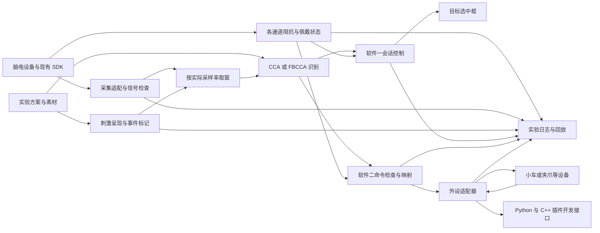

# SSVEP 定制开发方案与验收标准

版本 0.4　修订日期 2026 年 9 月 14 日

**本次架构收敛：**软件一增加阻抗检测，识别后仅显示选中框；移除独立结果校验与去重模块，必要检查归入取窗、识别和会话控制。详见[软件一架构 1.1](D:/PersonalWorkSpace/ssvep/docs/SSVEP实验设计软件架构.md)。以下整体工作量继续作为前期估算，本轮未重新估算工期，也未更新生产代码或历史原型。

本方案用于确定脑机接口开发套件中 SSVEP 应用的开发范围、工作量和验收方法。按用户最新交付口径，以当前 Windows SSVEP 拼写器及 Synchroni SDK 接入代码为基础，交付两套独立软件：完整可编辑的通用 SSVEP 控制软件，以及首发小车插件、可继续扩展机械手的脑控外设软件。两者共用基础库，分别安装、配置、记录和验收。

**修订范围的基础工作量为 43–67 人日，含约 20% 联调预留为 52–81 人日。** 相较 0.1 版增加两个独立应用和子进程插件架构的 9–14 人日，不重复计算既有编辑器及两类设备适配。按一人全职、每周 5 人日计算，开发交付约 11–17 周；采购文件要求的 15 个工作日试运行另列。估算以设备和协议可用、复用现有采集分析软件、两类外设均有可调用控制接口为前提。

本版按用户补充要求收敛：两套软件固定六个刺激目标，保留文字/图形/图像编辑和外设动作映射；刺激编码、相位、数量、采样率及窗口时长由内部配置管理，不对用户开放。取消连续三次确认，一个有效分类结果即可提交。

本轮交付为方案。应用源码未修改；“代码已有”“待开发”“待实测”分别表示代码审查结果、计划工作和仍需现场证据的能力，不能互相替代。

## 1 需求依据与交付边界

需求依据为[招标文件第八章采购需求](<D:/wechat/xwechat_files/wxid_lcxytorh0oj722_100a/msg/file/2026-09/招标文件-采购需求-脑机接口开发套件 -新版.docx>)，重点对应 8.1 第 2 项“脑机交互应用与二次开发”。本文引用条款位置，不使用未经版面核验的页码。

| 编号 | 文件要求 | 本次处理 |
| --- | --- | --- |
| R01 | 提供基于 SSVEP 范式的脑机接口控制软件 | 软件一完整交付，与 R02/R03 一同设计；软件二独立完成脑控外设闭环 |
| R02 | 刺激目标数量不少于 6 个 | 固定六目标模板满足要求，不提供目标数量设置；现有四十目标代码仅作为复用与回归基线 |
| R03 | 刺激界面的图形、文字、图像等内容可自定义 | 增加可视化编辑、素材导入、预览、保存和导入导出 |
| R04 | 至少 1 种脑控外部硬件设备，数量与脑电帽一致 | 软件完成设备绑定和控制；实物采购、配套数量由项目供货清单落实 |
| R05 | 至少 2 种脑控外部硬件设备的应用案例 | 暂按小车与桌面夹爪或简单机械臂两类案例估算，各需真实设备联调 |
| R06 | 完整 SDK 开发包，包含 API 文档、示例代码、编译环境说明，支持 Python/C++ 等主流语言 | 推荐同时交付 Python、C++ 调用示例及应用层 SDK，说明与厂商采集 SDK 的关系 |
| R07 | 与产品匹配的课程、PPT、实验指导书；提交资源清单；进行产品演示 | 纳入 SSVEP 专题教学资料和演示脚本，整套课程由总项目统筹 |
| R08 | ≥8 通道实时显示、参数调节；低通、高通、带通、50/60 Hz 陷波；原始数据存储导出，如 EDF+/BDF | 属于整套采集分析软件要求。先核验已有软件，缺项再启用补充工作包 |
| R09 | 采样频率 ≥500 Hz，支持 250/500 Hz 软件调节；其他硬件性能参数 | 整套设备/SDK 的能力和切换接口单独核验；本次两套 SSVEP 应用不设采样率切换入口，按实际速率与内部配置运行 |
| R10 | 永久软件使用授权；15 个工作日试运行；3 年免费质保及后续支持；部署与 API 等文档 | 软件打包及部署文档纳入本范围，长期服务投入单独安排 |

**产品口径修订。** 两套软件和插件式扩展依据本轮用户补充需求确定。R01/R02/R03 是需求拆分编号，六目标与三类内容编辑一并纳入软件一。软件二首发小车插件，后续机械手作为新插件；必要时提供机械手专属桌面入口和配置包。详见 [R01 架构与原型](D:/PersonalWorkSpace/ssvep/docs/R01软件架构与原型设计.md)及[插件规范](D:/PersonalWorkSpace/ssvep/docs/R01插件接口与扩展规范.md)。

**数量与案例的口径。** 采购表数量为 6 套。若每套配一顶脑电帽，则应有 6 台与脑电帽对应的外设，供分组实验使用；不能以一台共享外设替代。至少两类应用案例与每套实际配几台外设是两个要求，建议每组配小车，另提供经实机验证的第二类案例及其教学资源，最终按供货清单确认。

**核心范围不等同于整套采购完成。** 共模抑制比、采样精度、输入噪声、电极配套、实物照片、高校合作证明以及长期服务承诺，由硬件及供货服务方提供证据。其他脑机接口范式保留扩展接口，其实现不计入本轮 SSVEP 估算。

## 2 当前工程可以复用什么

本次核验对象为 `D:/PersonalWorkSpace/ssvep` 中的源代码和本地 SDK 快照。现有规划文档作为背景，能力结论以实际代码检查为准。

| 模块 | 已有实现 | 与本次要求的差距 |
| --- | --- | --- |
| 应用界面 | WPF 应用，设置页和刺激页，全屏展示 | 需要增加实验方案编辑、外设配置和控制状态 |
| 刺激呈现 | 固定 40 目标，文字标签，棋盘格或纯色刺激 | 目标表和键盘布局写在代码内，无图像导入和自定义图形编辑 |
| 脑电接入 | Python bridge 调用 Synchroni SDK，搜索、连接、读取 EEG 和阻抗 | SDK 版本未固定；采样率切换和实际硬件能力待核验 |
| 数据处理 | 原始输入通道记录，选择 8 通道用于分类，缓冲与丢包检查 | 分类路径固定选 8 通道；需区分采集通道配置与算法通道选择 |
| 识别 | CCA、FBCCA，默认 FBCCA；连续窗口、得分门限与冷却 | 缺少本项目条件下的实测准确率、空闲误触和端到端延迟报告 |
| 输出 | 数字、字母和文本编辑动作 | 当前提交路径只更新应用内文本框，没有外设驱动或指令应答 |
| 实验记录 | 采集流程、真反馈和假反馈、样本、阶段标记和帧记录 | 需要按刺激区间截取分类窗口、配置快照、回放和统一验收统计 |
| 开发交付 | C# 源码、Python bridge、核心自动测试 | 需补用户可直接使用的 SDK 包、Python/C++ 示例、部署和实验资料 |

2026 年 9 月 13 日基线验证：**67 项自动测试通过，0 项失败、0 项跳过；解决方案构建成功，0 个警告、0 个错误。** 本轮没有连接脑电帽或驱动外设，也没有获得真实受试者识别结果，因此以上结果只说明现有软件具备可继续开发的基础。

## 3 优先处理的工程问题

### 3.1 保持识别窗口的实际时长

当前 `MainWindow.xaml.cs` 固定 `SamplingRateHz = 250`、`WindowSamples = 625`。真实设备分类时虽然传入 SDK 采样率，读取窗口仍固定为 625 个样本。因此在 500 Hz 下，窗口相当于 1.25 秒，不能继续标成 2.5 秒。

改为根据“窗口时长 × 当前实际采样率”计算样本数，同步调整缓冲容量、就绪条件、状态显示和日志。2.5 秒窗口在 250 Hz 下为 625 个样本，在 500 Hz 下为 1250 个样本。检测到实际采样率或通道变化后，停止当前实验、重新确认设备元数据并清空旧缓冲，防止混用不同配置的数据。

### 3.2 固定并核验实际运行的 SDK

项目内 SDK 快照提交为 `b11ff17fcf3c226a7feb6dfb0bd05665f16d014d`；该快照的高层 `setParam` 实现没有 EEG 采样率切换分支。应用启动选项中的 SDK 依赖没有固定版本，因此快照版本也不能直接代表当前实际运行版本。

上游当前公开文档已经提供 v2 接口，说明交付时需要明确版本和接口兼容关系，不能只依据包名选择依赖。[Synchroni SDK 上游文档](https://github.com/SynchroniSI/synchroni-sensor-sdk)

开发开始时记录 SDK 版本、依赖清单、硬件型号、固件版本和实际支持的采样率。默认保留已验证的桥接方式；如果 500 Hz 切换依赖升级 SDK，先验证样本回调、通道字段、阻抗和断线恢复，再迁移。是否支持 500 Hz 必须以目标设备验证为准，软件重采样不能替代硬件原生 500 Hz 采集能力。

### 3.3 让分类窗口对应刺激区间

采集反馈目前读取“最新窗口”，可能包含刺激结束后的数据。保留已有样本序号、设备相对时间、主机接收时间、帧记录及标记，增加按试次刺激区间取窗的能力，并记录用于分类的起止样本序号。

屏幕绘制时间、电脑收到数据的时间与实际光刺激时间分别记录。已有光电检测块和帧日志可以复用，但它们本身不能证明硬件同步精度；精确时间对齐需由光电或等效实测支持。

### 3.4 区分真实脑控与教学演示

当前项目支持假反馈，适合教学和对照实验。新增外设输出应默认只接收真实识别决策；模拟数据、假反馈和离线回放的输出进入明确标识的演示通道。验收报告仅使用真实脑电和真实反馈数据计算脑控性能。

## 4 推荐的软件方案

### 4.1 操作流程与模块分工

软件一依次完成方案编辑、脑电与阻抗检查、在线识别、选中框反馈和记录；软件二依次完成插件选择、脑电与外设连接、动作绑定、脑控运行和反馈。两套软件均内置独立可用的默认方案；软件一可导出刺激包供软件二显式导入，导入后重新绑定当前插件动作。学生在运行页看到目标和结果，配置与诊断集中在设置页。

上图是共用的数据处理链，不表示只有一个应用。继续复用 WPF、C# 核心和 Python 采集桥接。软件一增加完整刺激编辑器，软件二增加插件宿主与能力驱动界面。插件以独立进程加载并声明连接、动作、限值与反馈；识别、决策、停止仲裁与日志由公共核心和宿主负责。同一脑电帽首版由一个应用独占，运行或暂停期间禁止切换外设插件。

### 4.2 固定目标与可编辑内容

首版固定六个目标，满足不少于六个刺激目标的要求。每个目标可以修改文字、图形或图像，用户不能添加/删除目标或切换目标数量。现有四十目标拼写器保留代码回归参考，不提供数量选择入口。

| 配置对象 | 用户范围 | 设计要求 |
| --- | --- | --- |
| 文字 | 中文、英文、数字、标签、经验证的字体及颜色 | 编辑后预览，文字在目标内完整显示 |
| 图形 | 矩形、圆形、方向箭头等内置图形及视觉样式 | 维持有效刺激区域，不改变内部编码 |
| 图像 | PNG/JPEG 素材、适应方式、可选说明文字 | 解码并缓存；素材随内容包保存，不依赖本机绝对路径 |
| 数量与布局 | 六个固定目标位置，仅编辑各目标内容 | 不提供增减目标和数量选择；内部校验模板一致性 |
| 编码、相位 | 不开放 | 固定频率表、相位和刺激方式由内部配置维护与实测 |
| 采样率、窗口时长 | 不开放 | 设备接入时核验实际速率，匹配并锁定内部运行配置 |
| 识别反馈 / 设备动作 | 软件一显示目标选中框；软件二绑定插件动作或停止 | 软件一不提供文本或选择事件输出；软件二动作参数在设备能力范围内 |

内容方案支持命名、复制、保存、导入导出和静态预览。导入包只能修改内容、素材和有效动作映射；不能覆盖刺激编码、相位、数量、采样率、窗口时长，也不能通过插件表单或高级模式开放这些字段。运行期间配置冻结。

内部配置校验频率唯一性及显示器条件。当前正余弦参考的 CCA/FBCCA 不能依靠“相同频率、不同相位”区分两个独立目标，此约束交由开发维护，不要求操作者设置或判断。图像及图形仍需验证有效闪烁面积与亮度变化。

### 4.3 识别与控制

沿用 CCA 作为教学比较基线、FBCCA 作为默认识别器。FBCCA 利用滤波器组和谐波信息，方法依据见[原始研究论文](https://pubmed.ncbi.nlm.nih.gov/26035476/)。论文结果不作为本设备性能承诺。

取消连续三次确认。软件一在有效窗口与算法结果检查后，由会话控制器核对当前运行状态和代次，立即更新唯一选中框；重复识别到同一目标保持原框，不设置独立结果去重模块。软件二保留命令有效性检查与命令 ID 去重，内部动作间隔用于限制重复派发。两套软件都不等待第二或第三个分类结果，也不增加人工确认。

窗口时长、调度间隔和识别阈值由内部配置管理，不在操作界面提供设置。联调可沿用当前 2.5 秒窗口和 0.25 秒调度间隔作为起点，实测后固定；采样率始终按设备实际数据核验。单次结果提交不代表只采一个样本，也不消除启动时准备完整有效窗口的时间。

保留数据缺失、丢包检查，明确增加阻抗模块，负责通道阻抗显示、接触状态与数据时效、开始前就绪检查。阻抗复用 SDK 连接，缓存值不能因新 EEG 到达而视为新测量；测量方式和更新时效以设备联调为准。算法选中通道需要与脑电帽物理位置对应，不能把前 8 个通道直接视为已验证的枕区通道。不同电极类型采用经设备方确认的质量判据，不把当前 500 kΩ 默认值当作通用验收标准。

### 4.4 通用外设接口与两类案例

先定义统一动作和状态，再由独立外设插件转换为具体设备协议。软件记录命令编号、目标设备、动作、发送时间、应答和超时；重试必须考虑去重，避免同一动作重复执行。通信方式由所选硬件决定，基础估算涵盖两类外设实际需要的通道，不包含同时实现所有串口、蓝牙和网络驱动。

| 案例 | 建议的 6 个目标 | 交付内容 |
| --- | --- | --- |
| 小车 | 前进、后退、左转、右转、停止、暂停脑控 | 目标方案、命令映射、主机示例、设备配置或示例固件、实验指导和实机记录 |
| 桌面夹爪或简单机械臂 | 张开、闭合、上移、下移、停止、暂停脑控；按实际设备能力调整，普通夹爪不默认支持位移 | 独立方案、协议适配、示例代码、实验指导和实机记录 |

外设初始处于停止或未使能状态。急停直接触发停止路径；脑电失效或设备失联时停止继续派发运动命令。对于运动设备，设备侧还应有通信超时停止能力，不能依赖失联后一定能收到主机停止命令。断线恢复后需重新使能，不重放之前的运动队列。

插件协议及默认动作必须匹配实际设备，不默认支持归位或位置反馈。机械手插件可后续开发，但整套验收前仍需完成要求的第二类真实外设案例。两套软件、两种语言示例、两个模拟插件都不能替代两类实物案例。

两类案例均需真实硬件验证。模拟器用于提前开发协议和界面，不能作为实物交付或脑控验收的替代证据。

### 4.5 二次开发包

提供版本化的应用层接口，允许 Python 和 C++ 示例完成设备状态读取、脑电数据订阅、兼容的内容方案加载、识别结果订阅、命令发送及状态反馈。建议通过本机服务接口连接现有识别核心，配套 Python 客户端和可编译的 C++ 示例，避免重复实现算法。

另提供插件开发包：清单、动作/设置/遥测描述、进程协议、生命周期、兼容性与契约测试；Python/C++ 通过同一协议开发外设插件。应用层 SDK 与插件 SDK 的调用职责分别说明，不要求插件接管脑电采集。

文档说明单位、通道顺序、采样率、时间戳含义、错误码、线程与回调约定、版本兼容关系。示例应能在另一台电脑上按说明独立构建和运行。厂商 SDK、应用层 SDK、两类外设案例分别列出清单和依赖。

此设计满足通过 Python/C++ 进行应用二次开发的目标；如果采购方要求 C++ 原生直接连接脑电帽、完全不依赖 Python 或本机服务，需要单独确认厂商接口，并调整开发范围。

### 4.6 数据与教学交付

复用现有 EEG、标记和帧记录，增加完整实验配置、素材清单、软件及 SDK 版本、滤波状态、实际采样率、通道映射、分类窗口、指令应答和异常原因。对外说明保存的是未经算法处理的 SDK 输入，还是设备或 SDK 已滤波后的信号；需要真正未滤波原始数据时，必须核验滤波关闭效果。

提供离线回放和试次统计，能够复现已记录的分类与命令结果，并计算正确、错误、超时、无输出、空闲误触和延迟。首版 SSVEP 教学资源建议包括四个实验：采集与信号检查、刺激内容与编码、CCA/FBCCA 比较、小车及第二类外设控制；配套课程提纲、PPT、实验指导和故障排查说明。

## 5 工作量估算

本版界面简化及单次结果提交纳入原估算范围，当前区间保留为预算参考；实施前按收敛后的工作包复核。

估算单位为人日，1 人日按 8 小时有效项目工作计。以下为基于当前代码的工程估算，包含开发、必要测试和文档，不是固定报价或已确认交期。

前提是使用现有硬件和 Windows 应用，目标 SDK 可提供所需数据；小车及第二类外设各有可用样机和明确协议，不需要从零开发控制板、整机固件或机械结构。全套采集分析软件的波形、滤波和标准导出能力若已具备，则以集成验证方式复用。

| 工作包 | 主要工作 | 人日 | 完成证据 |
| --- | --- | --- | --- |
| W01 | 需求对应、SDK 与设备能力核验、外设和验收范围确定 | 2–3 | 需求矩阵、版本基线、设备及协议清单 |
| W02 | 采集适配、250/500 Hz 时间窗口、缓冲和采集标记对齐 | 3–5 | 两档采样率验证、窗口和标记测试记录 |
| W03 | 固定六目标、文字图形图像编辑、素材管理、内容包与内部配置隔离 | 5–8 | 三类内容、编辑器、内容包跨机器加载与受限字段校验 |
| W04 | 内部识别参数、单次结果决策与停止路径、联调及耗时优化 | 3–5 | 算法比较记录、参数方案、决策测试 |
| W05 | 通用外设接口、小车及第二类外设适配和联调 | 6–9 | 两类可运行案例、应答与异常处理记录 |
| W06 | 应用层 SDK、Python/C++ 示例与 API 文档 | 3–5 | 两种语言示例独立运行、接口文档 |
| W07 | 配置和指令日志、回放、准确率及延迟统计 | 3–4 | 可回放实验包和可追溯统计报告 |
| W08 | 集成回归、刺激测量、真实脑电实验、分组环境及故障测试 | 5–8 | 测试报告、问题关闭记录、验收演示 |
| W09 | 固定依赖与部署包、操作文档、SSVEP 专题教学资料 | 4–6 | 安装包、源码、资料清单和异机部署记录 |
| 原基础小计 | W01–W09，不含新增产品及插件生命周期 | **34–53** | 保留原估算口径 |
| X01 | 两应用入口、独立配置、脑电独占和分别打包验证 | 2–3 | 两产品独立部署及无争用记录 |
| X02 | 插件发现、版本校验、子进程通信、生命周期和故障恢复 | 4–6 | 插件加载、退出、异常与兼容性记录 |
| X03 | 声明式设置/状态、能力驱动映射、模板和契约测试 | 3–5 | 不修改宿主接入新的示例插件 |
| 合计 | 两套软件及插件式扩展的基础范围 | **43–67** | 各包交付物齐全 |
| 联调预留 | 参数迭代、兼容性处理和缺陷修复，约 20%，向上取整 | **9–14** | 按实际问题使用 |
| 排期建议 | 基础工作加联调预留 | **52–81** | 不包含下列补充项和长期售后 |

### 5.1 整套采集软件缺项时的补充工作

先检查现有厂商软件。若其已提供功能并能提交验收证据，不重复开发；若要求全部整合到当前 SSVEP 应用，则按以下增量评估。

| 补充项 | 增量人日 | 边界 |
| --- | --- | --- |
| ≥8 通道实时波形、浏览和采集参数界面 | 3–5 | 面向教学采集，不含完整科研分析平台 |
| EDF+ 或 BDF 等标准格式导出及独立工具读回验证 | 3–5 | 先确认接受的格式；基础估算先实现一种获认可格式，不能仅改文件后缀 |
| 通用低通、高通、带通和 50/60 Hz 陷波配置及验证 | 2–4 | 当前算法滤波器组不直接等同于采集软件全部滤波功能 |
| 增量合计 | **8–14** | 仅对实际缺项计入 |

若三项均需新增，总基础工作量为 **51–81 人日**；统一加约 20% 预留后为 **62–98 人日**。这些工作仍不能替代硬件性能和服务条款的验收。

SDK 跨大版本迁移、厂商不提供必要接口、外设需要新固件或控制板、增加个人校准算法等情况，应在 W01 后单独重新估算。它们不属于可由 20% 缓冲自动覆盖的普通联调问题。

### 5.2 排期与资源口径

| 里程碑 | 工作包 | 累计基础人日 | 阶段结果 |
| --- | --- | --- | --- |
| M1 采集基线确认 | W01、W02 | 5–8 | 固定版本，真实采样率与窗口一致 |
| M2 可配置 SSVEP 与两应用入口 | W03、W04、X01 | 15–24 | 三类内容可编辑，两应用可独立运行 |
| M3 插件宿主、两类外设与开发接口 | W05、W06、X02、X03 | 31–49 | 插件可扩展，两类实物案例和语言示例可用 |
| M4 候选交付版 | W07、W08、W09 | 43–67 | 日志、实测、安装包和教学资料完整 |
| M5 试运行与最终验收 | 采购方使用与问题处理 | 另列 15 个工作日试运行 | 试运行问题关闭，提交验收材料 |

按一人全职投入、包括联调预留，M1–M4 约 11–17 周；加完整试运行周期约 14–20 周，硬件到货、场地和人员等待会顺延。增加开发或测试人员可以安排部分并行工作，但实机调参、协议验证和最终验收存在依赖，不能简单把工期除以人数。

项目旧排期曾按每周 12 小时投入。如仍沿用该投入量，52–81 人日对应约 **35–54 周开发时间**，试运行另列。新排期需明确实际投入，不自动套用全职交期。

本估算不包含硬件采购费用、外设整机研发、出差及场地、第三方商业许可、整套课程开发以及多年售后值守。长期支持的人力和成本另列。

## 6 验收标准

验收分为条款功能、工程质量和真实脑控效果三部分。表中标为“建议”的指标为本方案提出，招标原文没有给出相应数值。正式冻结性能指标前，先用目标设备和显示器进行小规模预试验，确认窗口、通道和参数可达到约定水平。

### 6.1 条款与功能验收

| 编号 | 对应要求 | 操作与通过条件 | 证据 |
| --- | --- | --- | --- |
| A01 | R01、R02 | 软件一载入至少 6 目标方案；各目标均能参与真实脑电识别，识别后可形成目标动作 | 现场演示、目标表、识别和指令日志 |
| A02 | R03 | 操作者不改源码，分别修改中文文字、基础图形、PNG/JPEG 图像；保存并重启后恢复一致 | 编辑前后截图、方案包 |
| A03 | R03 | 将含图片的内容包转移到另一台已安装软件的电脑，成功导入且素材一致；内部六目标配置保持一致；拒绝受限参数覆盖 | 跨机器记录、受限字段和不兼容模板拒绝记录 |
| A04 | R04 | 对交付外设逐台核对编号、设备绑定和控制；每组只控制绑定外设，无跨组串控 | 实物及脑电帽对应表、逐台记录 |
| A05 | R05 | 小车和第二类不同硬件设备分别完成完整实验；不仅是同一小车的两套界面 | 两类实机记录、两份示例和实验指导 |
| A06 | R06 | Python、C++ 示例在清洁环境按说明独立运行，能读取状态和数据、取得识别结果、完成一次指令调用 | 依赖清单、构建及运行记录 |
| A07 | R07 | 提供 SSVEP 资料清单、课程与 PPT、四个实验指导、部署操作说明和演示流程，条目与交付版本相符 | 版本化交付清单 |
| A08 | R09 | 在设备/SDK 联调配置中分别验证 250/500 Hz 能力；SSVEP 自动核验并锁定实际速率，无用户切换入口；内部 2.5 秒窗分别取 625/1250 样本 | 设备与 SDK 切换能力记录、两档日志及内部窗口测试 |
| A09 | R08 | 核验已有或补充的软件具备 ≥8 通道波形、规定滤波、原始数据存储及认可格式导出 | 功能演示；导出文件由独立工具读回，核对通道、单位、采样率、样本数和事件 |
| A11 | 用户明确的两产品交付 | 两套软件分别安装、启动、配置和保存记录，彼此不依赖对方进程；争用同一脑电帽时明确阻止第二次连接 | 两安装包、独立启动和设备占用记录 |
| A12 | 插件式扩展 | 小车插件实际控制；无需修改宿主加载新模拟插件，动态生成设置和动作；运行及暂停时禁止切换；故障阻止迟到动作 | 插件规范 P01–P08、P10 的验证记录；机械手实物另按 A05 验收 |
| A13 | 用户要求：单次结果与参数封闭 | 提供一个有效分类结果即可产生一条指令，重复同一结果不重复派发；无效/过期结果拒绝；两界面无编码、相位、数量、采样率、窗口时长入口，导入或插件也不能覆写 | 自动化与界面记录、模拟契约测试及实机复测 |
| A10 | R10 | 在未联网的交付环境中启动已安装软件并完成基础采集、存储和导出；核对永久授权文件及无到期依赖设计 | 授权材料、依赖说明、离线运行记录 |

A10 的短期运行测试本身不能证明永久使用期限，需同时核对授权与软件设计。A08、A09 是整套设备达标的联动要求，不能因本轮聚焦 SSVEP 而从总项目验收中遗漏。

### 6.2 建议的工程质量指标

| 编号 | 项目 | 建议通过条件与测量方法 |
| --- | --- | --- |
| Q01 | 真实采集稳定性 | 在约定电脑、设备、距离和通道配置下连续采集 60 分钟，软件无崩溃、采样链路不停止；缺失样本与断线必须记录。建议有效样本完整率 ≥99%，完整率按序号区间扣除丢失、补位及无效样本计算，重复样本不计为新增有效数据 |
| Q02 | 刺激呈现 | 固定显示器、分辨率及刷新率，连续运行 10 分钟。每种使用频率以光电或等效设备测量至少 60 秒，建议频率误差 ≤0.1 Hz；软件帧间隔大于额定周期 1.5 倍记为长帧，长帧占比建议 ≤1% |
| Q03 | 计算时延 | 在 6 目标、8 个算法通道、2.5 秒窗口及约定电脑上，单窗预处理与分类 P95 耗时建议 ≤250 ms，分别测 250/500 Hz；40 目标单独报告，不自动适用此指标 |
| Q04 | 外设协议 | 绕过脑电识别，对每类设备发送至少 100 条带编号的测试命令，包含停止；无错映射和重复动作。应答 P95 建议 ≤300 ms，从发送到收到设备应答计；机械动作完成时间按设备单独报告 |
| Q05 | 停止与故障 | 测试急停、脑电超过 500 ms 未更新、外设失联、软件异常退出；软件停止继续发送运动动作。运动设备的通信看门狗建议在最后一条有效控制消息后 ≤1 秒进入约定停止状态；恢复连接不自动重放动作 |
| Q06 | 数据可追溯 | 任选 10 个试次，能从目标提示追到刺激时段、分类样本区间、识别结果、命令编号及应答；同一数据与配置回放的目标结果一致。刺激与 EEG 的物理对齐误差另用实测报告表达 |
| Q07 | 分组运行 | 按最终配套数量同时运行，建议至少 30 分钟；核对绑定、无串控、无日志覆盖，逐组报告完整率。默认每组独立电脑；一台电脑同时接多顶帽属于另一个部署范围 |

这些指标须写入固定的测试环境，包括软件与 SDK 版本、电脑、操作系统、显示器设置、设备和固件、电极配置、无线距离与干扰条件。发生异常时保留全部日志，不能仅报告运行良好的片段。

### 6.3 建议的真实脑控性能验收

初验建议采用 **6 目标、真实 EEG、真实反馈**。至少 5 名参与者，每人每个目标 10 次，共 60 次、总计至少 300 次；目标随机均衡呈现，预先固定参数与休息安排。调参使用单独数据，正式测试阶段不按测试答案继续调参。

| 指标 | 统计口径 | 初始建议目标 |
| --- | --- | --- |
| 指令选择正确率 | 每试次从刺激开始计时，以首条提交指令判断；正确且在 5 秒截止前提交计成功，错误、未输出或超时计失败 | 每人正确率分别报告；个体正确率平均值 ≥85%，单人建议 ≥75% |
| 决策时间 | 从刺激开始到首条提交指令；报告正确试次的中位数、P95，同时报告全部试次成功率、错误数和超时率 | 正确试次中位数建议 ≤4 秒，P95 ≤5 秒 |
| 空闲误触 | 每人至少 5 分钟无意图选择测试，实验布局仍呈现；记录全部被提交的非停止动作 | 建议每人 5 分钟不超过 1 次，另报告汇总次数/分钟 |
| 重复提交 | 一次试次有效提交后到下一试次允许选择前，额外出现的动作计重复 | 验收配置下无重复动作 |

只允许按预先定义的客观原因，如设备掉线或数据损坏，标记无效试次；无效数、原因和重测结果必须单独报告。识别错误或超时不能按“无效数据”剔除，也不能用假反馈、模拟信号或离线数据成绩替代在线结果。个体差异较大时，先处理电极位置、信号质量、刺激测量和窗口参数，再评估是否新增个人校准算法。

### 6.4 试运行与验收记录

候选交付版完成后进入文件规定的 15 个工作日试运行。建议记录每组启动、连接、实验、导出和外设异常，影响采集、保存、停止和正常控制的缺陷修复并复测后，提交最终验收材料。新增功能和重大协议变更重新确定版本及验证范围。

每项验收记录至少包含：验收编号、版本、设备编号、测试环境、前置配置、操作步骤、预期结果、实际结果、原始证据路径、问题编号、复测结论和确认人员。所有建议指标在正式验收前形成双方认可的版本。

## 7 交付物清单

1. 两套独立软件部署包：SSVEP 实验设计与控制、SSVEP 脑控外设宿主；包含固定依赖、各自配置与记录、版本和卸载说明。
2. 完整应用源码、构建说明、依赖锁定清单与许可清单。
3. 固定六目标内容模板、文字/图形/图像素材、内部运行配置与版本清单；既有拼写器代码保留回归参考。
4. 小车正式插件和第二类外设插件/案例包，包含协议、默认方案、运行示例、设备配置或适用固件、实机记录；插件开发模板、契约与测试工具随附。
5. 厂商采集 SDK 与应用层 SDK 清单、API 文档、Python 和 C++ 示例及编译环境说明。
6. 操作手册、部署配置说明、SSVEP 课程提纲及 PPT、四个实验指导、故障排查说明。
7. 验收方案、原始实验记录、效果统计、问题关闭和试运行记录。
8. 若启用补充工作包，提供采集分析功能说明、认可格式示例文件与独立读回验证结果。

整套供货还需补齐设备操作与维护保养资料、产品组成和重要技术参数说明、至少 3 张高清实物及重要部件照片、高校合作案例与教学资源总清单。其内容须由实际产品和已发生的项目支撑。

## 8 开发开始前需要确定的信息

| 信息 | 本方案暂定口径 | 影响 |
| --- | --- | --- |
| 脑电设备与 SDK | 以当前项目的 Synchroni 接入为基线；型号、固件和实际运行版本待核验 | 500 Hz、采样率切换、原始数据与通道控制是否可实现 |
| 两类外设 | 小车加桌面夹爪或简单机械臂，有既有控制接口 | W05 估算和协议测试方法 |
| 基础采集分析软件 | 优先复用已有厂商软件 | 是否新增 8–14 人日补充工作 |
| 语言接口 | Python/C++ 应用层接口，允许调用本机服务 | 是否需要 C++ 原生采集库及额外打包工作 |
| 显示和部署环境 | Windows；每组一台电脑，先验证一套显示配置 | 刺激测量、分组干扰与支持范围 |
| 人员投入 | 工期同时给出全职和每周 12 小时两种换算 | 交期不由人日直接等同得出 |
| 性能指标 | 本方案建议值，待小规模预试验后固定 | 实测调参与是否需要校准算法 |

优先确定设备型号、SDK 实际版本和外设协议即可启动 W01；教学界面细节可以在 W03 的预览阶段继续细化。

## 9 核验证据与责任边界

当前代码的主要依据如下，均为本地实际读取的实现。

| 结论 | 依据 |
| --- | --- |
| 固定 40 目标及频率表 | [StimulusLayout.cs](D:/PersonalWorkSpace/ssvep/src/Ssvep.Speller.Core/Stimulus/StimulusLayout.cs) |
| 固定键盘布局，文字及棋盘格渲染，已有帧记录与光电检测块 | [StimulusCanvas.cs](D:/PersonalWorkSpace/ssvep/src/Ssvep.Speller.App/StimulusCanvas.cs) |
| 625 样本窗口、最新窗口取数、仅文本输出、采集时保存原始输入通道 | [MainWindow.xaml.cs](D:/PersonalWorkSpace/ssvep/src/Ssvep.Speller.App/MainWindow.xaml.cs) |
| 真实采集桥接和滤波参数范围 | [synchroni_eeg_bridge.py](D:/PersonalWorkSpace/ssvep/src/Ssvep.Speller.App/Bridges/synchroni_eeg_bridge.py) |
| 运行依赖未固定版本 | [SynchroniBridgeOptions.cs](D:/PersonalWorkSpace/ssvep/src/Ssvep.Speller.Core/Devices/SynchroniBridgeOptions.cs) |
| 本地 SDK 高层配置范围 | [sensor_profile.py](D:/PersonalWorkSpace/ssvep/.tools/synchroni-sensor-sdk/sensor/sensor_profile.py) |
| 8 通道和阻抗、数据新鲜度门控 | [StimulusReadinessEvaluator.cs](D:/PersonalWorkSpace/ssvep/src/Ssvep.Speller.Core/Devices/StimulusReadinessEvaluator.cs) |
| 采集样本、标记、帧和会话保存 | [DataCollectionLogWriter.cs](D:/PersonalWorkSpace/ssvep/src/Ssvep.Speller.Core/Logging/DataCollectionLogWriter.cs) |
| 默认分类方法 | [FbccaClassifier.cs](D:/PersonalWorkSpace/ssvep/src/Ssvep.Speller.Core/Classification/FbccaClassifier.cs) |
| 当前判断参数 | [DecisionSettings.cs](D:/PersonalWorkSpace/ssvep/src/Ssvep.Speller.Core/Decision/DecisionSettings.cs) |
| 旧版每周投入口径 | [project_plan.md](D:/PersonalWorkSpace/ssvep/docs/project_plan.md) |

源码存在、自动测试通过与构建成功不能替代真实硬件或招标条款验收。现有 `BleEegStream` 是保留的未实现入口，真实设备复用路径为 `SynchroniBridgeEegStream`，不按“已有原生蓝牙驱动”估算。

文件要求的服务承诺还包括故障响应不超过 12 小时、无法及时修复时的备用设备安排，以及验收后至少 10 年远程支持和维修备件供应。这些要求应由供货及服务方案落实，不包含在一次性开发人日中。
