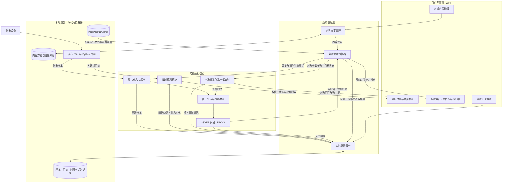

# SSVEP 实验设计软件架构

设计稿 1.1 · 2026-09-14

本图聚焦第一套“SSVEP 实验设计”软件，基于现有 Windows / WPF / C# 工程和 Synchroni SDK 桥接设计。本次增加阻抗检测模块，取消独立的结果校验与去重模块，识别后只在对应刺激目标外显示选中框。

首版固定六目标，用户可修改文字、图形、图像。刺激编码、相位、目标数量、采样率和窗口时长由内部配置管理，不提供用户调整入口。单个有效识别结果即可更新选中框，不进行连续三次确认。

2026-09-15 已按本架构开展生产实现，新增独立入口 `src/Ssvep.Studio.App`；复用逻辑位于 `src/Ssvep.Speller.Core/Studio`，原拼写器保留为回归参考。交互原型保留历史版本；当前桌面应用的操作与验证边界见[使用说明](D:/PersonalWorkSpace/ssvep/docs/SSVEP实验设计使用说明.md)。以下模块职责与验收规则继续作为设计依据。

2026-09-26 增加 10–20 电极位置图与手动通道映射。`StudioHeadMap` 提供电极点击与阻抗状态显示，`StudioElectrodes` 管理位置目录、唯一映射校验和配置保存；`StudioRuntime` 继续统一管理实际 SDK 通道选择及运行锁定。真实设备不推断接线顺序，模拟位置不覆盖真实设置。每次记录增加冻结的 `electrodeBindings`，原始样本及算法仍按 SDK 通道索引处理。

2026-10-01 调整 SDK 丢样处理：诊断接入按本次连接累计 EEG 丢样提示次数与采样点数，界面底部显示计数。丢样提示不触发终止或断连；取窗模块在 `IsLost` 或序号缺口处重新积累连续数据，会话保持运行并清除旧选中框，缺口前的后台结果不能重新显示边框。真实断连、格式变化与其他致命错误继续按异常处理。

2026-10-02 阻抗改为显示与记录用途。高阻抗、未知、缺失或过期均不阻止开始/恢复，也不触发自动暂停；数值、颜色和数据时效继续如实显示，界面标注“仅供参考”。开始仍校验设备连接、有效脑电、实际采样率及识别通道。

## 1 软件架构图

箭头表示主要调用或数据传递，不表示独立进程。会话控制器创建同一份只读运行上下文，交给呈现、取窗、识别与阻抗模块；图中省略重复参数连线。阻抗和脑电复用同一个 SDK 连接。

## 2 模块职责

| 模块 | 主要职责 | 边界 |
| --- | --- | --- |
| 刺激内容编辑与方案管理 | 编辑六个固定位置的文字、图形或图片，预览、保存、载入和导入导出 | 内容包不能覆盖内部受限参数；运行时冻结内容 |
| 阻抗检测模块 | 读取各通道阻抗，转换单位、判断接触状态，向界面和会话提供状态 | 复用 SDK 数据；未知、无效和过期值不能当作正常值 |
| 头图与通道对应表 | 10–20/扩展电极位置、CH 绑定、图和列表同步选择、按通道数本地保存 | 一对一映射；运行/暂停锁定；模拟与真实配置分开；示意坐标不用于临床定位 |
| 实验会话控制器 | 准备检查、启动、暂停、恢复、结束；接收识别结果并更新选中目标 | 唯一会话状态所有者；运行代次不匹配或停止后返回的结果不能改变画面 |
| 刺激呈现与选中框绘制 | 固定六目标刺激、帧标记；根据选中目标状态绘制唯一选中框 | 边框绘制在刺激区域外的独立显示层，不改变内部刺激编码、相位、有效面积与时序 |
| 脑电接入与缓冲 | SDK 连接、元数据、样本序号、输入缓冲及连续性检查 | 核验实际采样率，不把其他速率输入按固定 250 Hz 解释 |
| 窗口生成与质量检查 | 按内部时长与实际采样率生成刺激开始后的完整有效窗口 | 无效窗口不交给识别；不跨暂停、重连或配置变化混用数据 |
| SSVEP 识别 | 运行现有 FBCCA，返回有效目标或无有效结果，保留得分与窗口定位 | 目标范围和算法结果有效性检查在识别模块内完成；得分不显示为概率 |
| 实验记录服务 | 保存内容/配置快照、原始样本、阻抗、刺激时序、识别结果及选中状态变化 | 内部记录用于复盘；不增加应用对外的选择事件接口或文本输出 |

## 3 “单次结果校验与去重”是否过度设计

**在本软件仅显示选中框的范围内，将它独立为一个模块属于过度设计，应移除。** 连续两次识别到目标 A，画面仍只有 A 的一个框，不会产生两次外设动作或两段文本。因此无需结果唯一 ID 去重服务、命令队列或重复派发间隔。

必要检查归入已有模块：

| 必要检查 | 放置位置 | 作用 |
| --- | --- | --- |
| 样本完整、连续，窗口属于当前刺激区间 | 窗口生成与质量检查 | 防止用不适用的数据计算 |
| 目标在六目标表内，算法结果满足内部有效性判据 | SSVEP 识别 | 返回有效目标或无有效结果 |
| 当前仍在运行，结果属于当前会话及运行代次 | 实验会话控制器 | 防止暂停、停止、重连后的迟到结果重新点亮选中框 |
| 后台结果不会倒序覆盖新结果 | 会话控制器配合单任务识别调度 | 首版串行识别、不积压旧窗口；保留窗口序号用于定位 |
| 再次识别到同一目标 | 界面状态绑定 | 保持原框，不新增框、不重复播放反馈动画 |

这些检查不需要连续三次确认，也不需要新建一个“精简去重服务”。内部记录仍保存连续窗口对同一目标的识别结果，便于分析稳定性。

第二套脑控外设软件存在真实动作发送，仍由其命令派发模块处理命令有效性、重复执行和停止仲裁；这些职责不强加给第一套软件。

## 4 阻抗模块设计

阻抗检查放在实验准备界面，与设备连接和佩戴参考组合。显示通道名称、阻抗值（kΩ）、接触状态和数据时效；有已核验的电极位置映射时可用头皮位置图，否则用通道列表。各通道都可查看，阻抗状态不参与开始或恢复实验的条件判断。

- **状态判断：**按设备与电极类型对应的内部判据显示正常、需调整或接触不良。状态配文字，不能只靠颜色区分。零值、无效值、未收到数据及过期数据明确显示“未知 / 待更新”，不能显示为佩戴良好。
- **数据时效：**分别记录阻抗接收时间与 SDK 提供的测量时间；未提供测量时间时明确标记。不能因为 EEG 持续到达，就把缓存阻抗视为刚测得的值。阻抗更新语义和允许的数据年龄需经设备联调确认。
- **开始与恢复：**检查设备连接、有效脑电、实际采样率与识别通道，再准备新的识别窗口；不要求阻抗达标，也不增加确认弹窗。
- **运行中：**按 SDK 支持的更新方式监测。接触异常或阻抗过期更新参考状态与记录，继续运行；实际脑电中断等运行异常仍按相应规则处理。
- **测量方式：**当前桥接随脑电样本转发阻抗字段。是否需要主动测量、能否与 EEG 同时进行，按目标 SDK 和硬件确认；若需要独占测量模式，则在准备或暂停阶段测量，结束后重新积累有效窗口。运行中的监测与过期判定必须符合这一实际测量方式。

内部阻抗判据不新增普通用户调节入口。现有代码中的分级默认值不能直接作为所有电极的验收标准，需设备方确认。

## 5 选中框与实验流程

选中框是本软件唯一的在线识别反馈。不设置文本结果区、文字累积、选择记录侧栏或对外选择事件接口；刺激目标本身仍支持自定义文字。实验记录页可以查询历史数据用于复盘。

| 场景 | 画面行为 |
| --- | --- |
| 刚开始、等待完整有效窗口 | 显示六目标，无选中框 |
| 首个有效结果为 A | 立即在 A 外显示选中框 |
| 下一有效结果仍为 A | 保持 A 的框，不重复闪动 |
| 下一有效结果为 B | 移除 A 的框，仅在 B 外显示框 |
| 当前窗口没有有效识别结果 | 清除选中框 |
| SDK 丢样或样本序号缺口 | 保持刺激与连接，清除旧框，自动积累连续数据后继续识别 |
| 暂停、结束、断连或信号故障 | 停止刺激，立即清除框，旧结果失效 |
| 用户恢复 | 重新检查脑电数据与通道，积累新窗口后再显示选中框 |

正常等待下一次计算期间维持上一次有效选中状态；只有新结果或会话状态变化才更新。边框不改变目标内部闪烁，不额外添加闪烁确认动画。实际刺激时序仍需后续实测。

开始时冻结内容与运行配置，并创建记录。实际采样率与已验证配置不匹配时阻止开始。采集、阻抗、刺激、识别和选中状态通过会话、运行代次、时间及样本定位关联。原始数据或日志写入失败时显式中止或阻止会话。没有目标真值时不展示准确率。

## 6 实现依据与设计验收

采用一个 WPF 桌面应用进程，保留现有 SDK Python 桥接进程。识别和记录在后台运行，绘制不等待算法、设备通信或磁盘。核心算法与会话规则不依赖 WPF，供第二套软件按需复用。

| 现有代码依据 | 复用与调整方向 |
| --- | --- |
| [synchroni_eeg_bridge.py](D:/PersonalWorkSpace/ssvep/src/Ssvep.Speller.App/Bridges/synchroni_eeg_bridge.py) | 已读取并转发 sample.impedance；补充实际测量语义和时效验证 |
| [SynchroniBridgeDiagnostics.cs](D:/PersonalWorkSpace/ssvep/src/Ssvep.Speller.Core/Devices/SynchroniBridgeDiagnostics.cs) | 已保存通道阻抗；增加与 EEG 更新时间分离的阻抗状态，避免缓存值被误认为新测量 |
| [ChannelImpedance.cs](D:/PersonalWorkSpace/ssvep/src/Ssvep.Speller.Core/Devices/ChannelImpedance.cs) | 已有单位换算与 Unknown 状态；判据采用经设备确认的内部配置 |
| [StimulusReadinessEvaluator.cs](D:/PersonalWorkSpace/ssvep/src/Ssvep.Speller.Core/Devices/StimulusReadinessEvaluator.cs) | 已有缺失阻抗、阻抗过高的就绪检查；复用前核对通道映射与时效 |
| [MainWindow.xaml.cs](D:/PersonalWorkSpace/ssvep/src/Ssvep.Speller.App/MainWindow.xaml.cs) | 提取会话控制与阻抗显示职责；软件一移除文本提交路径，以选中目标状态替代；按实际采样率取窗 |
| StimulusCanvas / FbccaClassifier / 现有日志写入器 | 增加六目标内容和独立边框绘制；保留单窗识别与记录基础，不接入连续三次确认流程 |

后续实现按以下行为验收：

1. 固定六目标，支持文字、图形和图像编辑，五项受限参数没有用户设置或导入覆盖入口。
2. 各通道阻抗可显示；缺失、异常和过期值不会显示为正常，异常参考状态可定位到通道；阻抗不限制开始/恢复，也不导致自动暂停。
3. 一个有效结果即可显示一个选中框；同目标重复结果不增加框，新目标替换旧框。
4. 软件一没有文本累积、选择事件输出和独立去重模块；必要检查位于取窗、识别和会话控制中。
5. 暂停、结束、断连后旧结果不能重新显示边框；恢复后必须使用新窗口。
6. 选中框不改变内部刺激时序；阻抗、样本、识别和会话记录可关联复盘。

本轮已核对现有阻抗数据通路，尚未验证真实硬件的阻抗更新行为、接触判据或实际识别效果。相关设计：[两套软件总体架构](D:/PersonalWorkSpace/ssvep/docs/R01软件架构与原型设计.md)。
