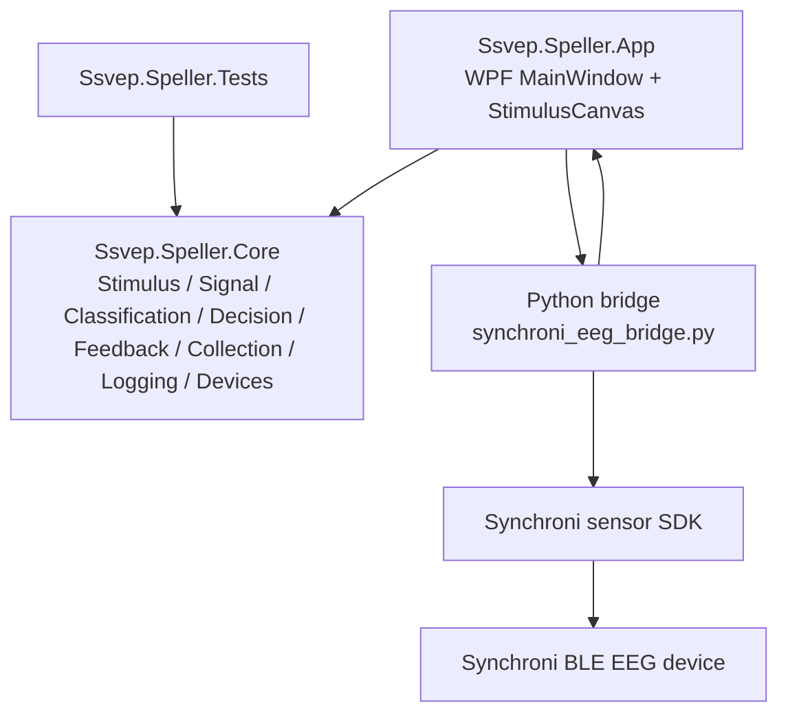
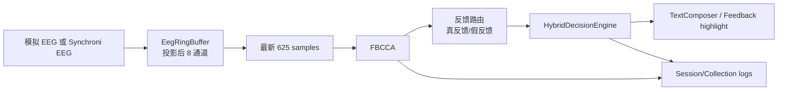

# 架构总览

#architecture #moc

## 核心结论

当前系统是一个分层但不重的 WPF 原型：

1. **App 层**：窗口、页面、按钮、刺激绘制、运行状态机、设备连接入口。
2. **Core 层**：稳定业务逻辑，包括目标编码、信号缓冲、分类、决策、反馈、采集、日志、设备抽象。
3. **Bridge 层**：Python 进程对接 Synchroni SDK，把设备事件转成 C# 易解析的 NDJSON。
4. **Tests 层**：用 xUnit 锁住核心算法、数据结构、门控、日志和反馈行为。

## 架构图

## 运行时主循环

## 关键设计取舍

| 主题 | 当前选择 | 原因 |
| --- | --- | --- |
| 技术栈 | `.NET 8 + WPF` | Windows PC 端全屏刺激和本地设备接入方便 |
| 无训练识别 | FBCCA 默认，CCA 基线 | 不需要个人校准数据，容易做模拟闭环和单元测试 |
| 设备接入 | C# 启动 Python bridge | 复用 Synchroni SDK，C# 侧只处理统一流接口 |
| 通道策略 | 手动选择 8 个通道，投影为算法输入 | 兼容 32 通道设备，也能只用枕区通道 |
| 就绪门控 | 连接、样本、通道、阻抗都满足才算 | 降低“有界面但没数据”的误判 |
| 反馈模式 | 真反馈和假反馈分离 | 支持真实闭环和实验对照 |

## 架构笔记

- [[系统架构]]
- [[模块边界]]
- [[代码阅读指南]]
- [[运行时数据流]]
- [[页面结构]]
- [[会话日志]]
- [[测试地图]]

