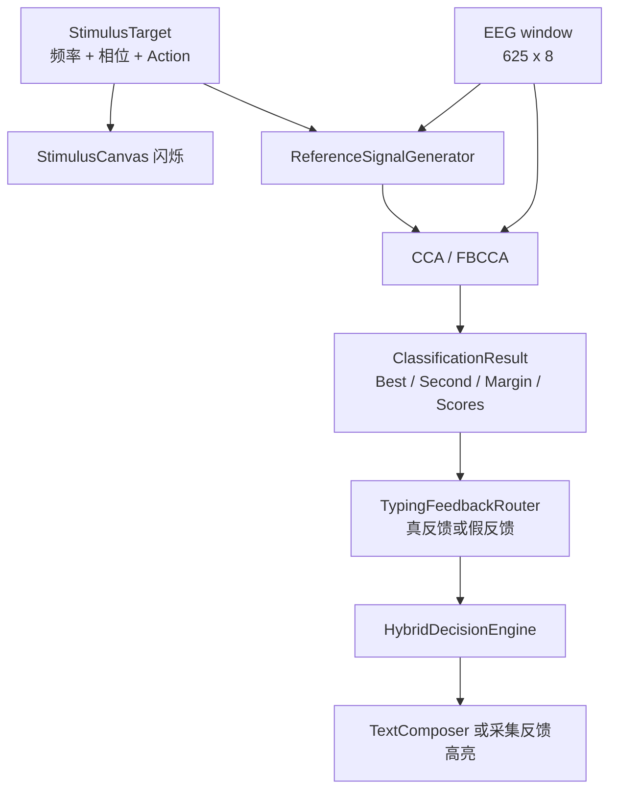

# 算法总览

#algorithm #ssvep #moc

## 算法链路

## 当前算法栈

| 阶段   | 当前实现                                             | 文件                                                                                                     |
| ---- | ------------------------------------------------ | ------------------------------------------------------------------------------------------------------ |
| 目标编码 | 40 目标 QWERTY + 数字 + 命令，`8.0-15.8 Hz`，步进 `0.2 Hz` | [StimulusLayout.cs](../../src/Ssvep.Speller.Core/Stimulus/StimulusLayout.cs)                           |
| 参考信号 | 每个频率生成 `sin/cos` 参考矩阵，支持谐波和相位                    | [ReferenceSignalGenerator.cs](../../src/Ssvep.Speller.Core/Classification/ReferenceSignalGenerator.cs) |
| 基线分类 | CCA                                              | [CcaClassifier.cs](../../src/Ssvep.Speller.Core/Classification/CcaClassifier.cs)                       |
| 默认分类 | FBCCA，默认 3 个谐波/子带                                | [FbccaClassifier.cs](../../src/Ssvep.Speller.Core/Classification/FbccaClassifier.cs)                   |
| 反馈路由 | 真反馈使用真实 best，假反馈使用预设目标 synthetic result          | [TypingFeedbackRouter.cs](../../src/Ssvep.Speller.Core/Feedback/TypingFeedbackRouter.cs)               |
| 在线决策 | 连续一致 + 最低得分 + margin + 冷却                        | [HybridDecisionEngine.cs](../../src/Ssvep.Speller.Core/Decision/HybridDecisionEngine.cs)               |
| 输出   | Digit / Letter / Space / Delete / Pause / Clear  | [TextComposer.cs](../../src/Ssvep.Speller.Core/Output/TextComposer.cs)                                 |

## 默认参数

| 参数 | 值 | 来源 |
| --- | ---: | --- |
| 采样率 | `250 Hz` | `MainWindow.SamplingRateHz` / 设备 metadata |
| 窗口长度 | `625 samples` | `MainWindow.WindowSamples` |
| 窗口时长 | `2.5 s` | `625 / 250` |
| 滑动步长 | `0.25 s` | `recognitionTimer.Interval` |
| 算法通道数 | `8 ch` | `ChannelMontage.OutputChannelCount` |
| FBCCA harmonicCount | `3` | `new FbccaClassifier(harmonicCount: 3)` |
| RequiredConsistentWindows | `3` | `DecisionSettings`，UI 可调 |
| MinBestScore | `0.55` | `DecisionSettings`，UI 可调 |
| MinScoreMargin | `0.08` | `DecisionSettings`，UI 可调 |
| CooldownWindows | `2` | `DecisionSettings` |

## 算法笔记

- [[SSVEP 刺激编码]]
- [[CCA]]
- [[FBCCA]]
- [[信号窗口与缓冲]]
- [[混合异步决策]]
- [[反馈模式]]

## 和算法调研文档的关系

完整算法背景见 [ssvep_algorithms_survey.md](../ssvep_algorithms_survey.md)。当前代码落地的是无训练 CCA/FBCCA；需要个人校准模板的算法属于后续版本。

