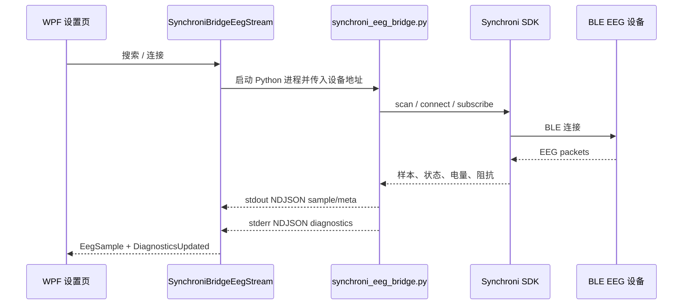

# 设备与数据流

#device #dataflow #synchroni #moc

## 数据源

当前 App 有两个 EEG 数据源：

1. **模拟脑电**：由 `SyntheticSsvepSignal` / `SimulatedEegStream` 生成，可在无设备时验证算法和闭环。
2. **Synchroni 设备**：C# 通过 `SynchroniBridgeEegStream` 启动 Python bridge，Python bridge 使用 Synchroni SDK 连接 BLE 设备。

## Synchroni 链路

## 样本进入算法前发生什么

1. `SynchroniBridgeEegStream.ReadSamplesAsync` 解析 bridge 输出。
2. `MainWindow.StartSdkStreamAsync` 后台读取每个 `EegSample`。
3. `GetMontageForSample` 确保当前输入通道数可用。
4. `ChannelMontage.Project` 从原始通道中取出用户选择的 8 个通道。
5. 投影后的样本写入 `EegRingBuffer`。
6. 打字模式每 250ms 尝试读取最新 625 samples 分类。
7. 采集模式在后台把设备返回的全部原始 EEG 通道写入 `samples.csv`；选中的 8 通道只用于实时分类。

## 通道筛选

- Synchroni 设备可返回 32 通道。
- 算法固定吃 8 通道矩阵。
- 设置页会按设备通道数生成复选框。
- 用户必须选中 8 个不重复通道。
- 更换通道后，SDK ring buffer 会清空并重新积累 2.5 秒窗口。
- 阻抗门控只检查当前选中的 8 个通道。

## 就绪门控

Synchroni 模式下开始刺激或采集前必须满足：

- 已收到设备 metadata。
- 设备通道数至少为 8。
- 已收到 EEG 样本。
- 当前通道筛选有效。
- 所选 8 通道都有有效阻抗。
- 所选 8 通道阻抗不超过设置页阈值。

详见 [[阻抗与就绪门控]]。

## 相关

- [[EEG 数据接口]]
- [[Synchroni SDK Bridge]]
- [[设备诊断参数]]
- [[信号窗口与缓冲]]
- [[运行与排障]]
