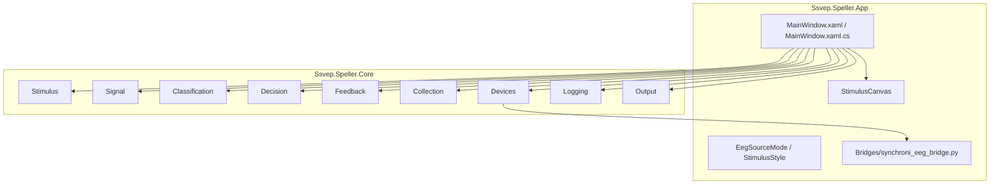

# 系统架构

#architecture #runtime

## 分层

## App 层职责

`MainWindow` 目前承担四类职责：

- UI 事件：按钮、ComboBox、Slider、页面切换、全屏。
- 运行控制：开始/停止打字闭环、开始/停止采集、计时器 tick。
- 设备连接：搜索、连接、断开、读取 SDK 样本、更新诊断。
- UI 状态：就绪文本、阻抗面板、通道筛选、输出文本、刷新率。

`StimulusCanvas` 是单独的自绘控件，负责绘制 40 个刺激目标、棋盘格/纯色闪烁、cue/feedback 边框和帧率统计。

## Core 层职责

| 命名空间 | 责任 | 典型文件 |
| --- | --- | --- |
| `Stimulus` | 目标、频率、动作、布局 | `StimulusLayout.cs`、`TargetAction.cs` |
| `Signal` | EEG 样本、流接口、环形缓冲、通道投影、合成信号 | `IEegStream.cs`、`EegRingBuffer.cs`、`ChannelMontage.cs` |
| `Classification` | CCA/FBCCA 和参考信号 | `CcaClassifier.cs`、`FbccaClassifier.cs` |
| `Decision` | 连续窗口决策、阈值、冷却 | `HybridDecisionEngine.cs` |
| `Feedback` | 真/假反馈模式和路由 | `TypingFeedbackRouter.cs` |
| `Collection` | 数据采集 trial 调度和阶段推进 | `DataCollectionScheduler.cs`、`DataCollectionController.cs` |
| `Devices` | 设备 bridge、解析、诊断、阻抗门控 | `SynchroniBridgeEegStream.cs`、`StimulusReadinessEvaluator.cs` |
| `Logging` | Session/collection 日志 | `SessionLogWriter.cs`、`DataCollectionLogWriter.cs` |
| `Output` | 将 TargetAction 应用到文本 | `TextComposer.cs` |

## 状态机概念

项目里有三套“模式”，不要混淆：

| 模式 | 类型 | 值 | 控制内容 |
| --- | --- | --- | --- |
| 数据源模式 | `EegSourceMode` | `Simulated` / `SynchroniSdk` | EEG 从哪里来 |
| 运行模式 | `AppRunMode` | `Typing` / `DataCollection` | 点击开始后跑打字还是采集 |
| 反馈模式 | `TypingFeedbackMode` / `CollectionFeedbackMode` | 真/假/混合 | 最终输出或反馈目标从哪里来 |

## 设计风格

- Core 尽量保持无 WPF 依赖，方便单元测试。
- App 层目前较集中，优点是原型迭代快，缺点是 `MainWindow.xaml.cs` 已经偏大。
- Bridge 用进程隔离，C# 不直接绑定 Python SDK 对象，只读文本协议。

