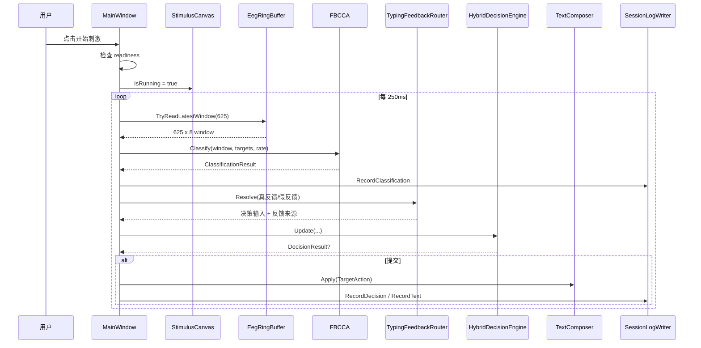
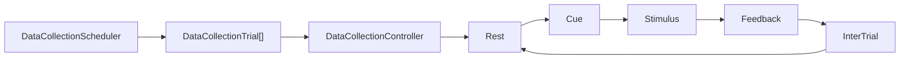

# 运行时数据流

#runtime #dataflow

## 打字闭环

## 模拟模式和真实设备模式差异

| 阶段 | 模拟模式 | Synchroni 模式 |
| --- | --- | --- |
| 数据来源 | 当前 focus 目标生成 synthetic SSVEP | SDK bridge 实时样本 |
| readiness | 直接 ready | 设备、样本、通道、阻抗必须满足 |
| ground truth | 每个窗口记录 focus target | 当前不记录真实注视目标 |
| 窗口来源 | 当场生成 625 x 8 | 从 ring buffer 读取最新窗口 |

## 数据采集流程

数据采集不用 `recognitionTimer`，而用 `collectionTimer` 每 50ms 推进阶段。EEG 样本仍由后台 SDK 读取任务持续写入采集日志。

Feedback 阶段根据 trial 的 `FeedbackSource` 决定：

- `TrueClassifier`：读取最新窗口分类，高亮分类 best。
- `ShamPreset`：高亮 scheduler 预设目标。

## 停止流程

停止刺激或采集时：

1. 停止 `recognitionTimer` 和 `collectionTimer`。
2. `StimulusCanvas.IsRunning = false`。
3. 清空 cue/feedback 高亮。
4. 写入帧率统计。
5. Dispose session/collection log writer。
6. 不自动断开设备；设备由 Disconnect 控制。

